# 实验结果

硬件：tams61，RTX 4060 8 GB，Warp 1.18.0，MuJoCo 3.3.7。运行目录在 tams61 的 `runs/` 下（不进仓库）。

## 2026-10-16 香蕉单刀：接触刚度与步长

commit `c3ca5c6`；`franka_run --motion feedback --controller serl --material paper-banana --duration 12 --record`；`runs/dt_sweep_20261016/`。

| 步长 | 接触参数 | 下刀段平均 Fz [N] | 下刀段冲量 [N·s] | 峰值 [N] | 结果 |
|---|---|---|---|---|---|
| 25 μs | 物理刚度 | 0.160 | 0.408 | 0.755 | 两块 |
| 50 μs | 物理刚度 | 0.158 | 0.402 | 0.801 | 两块 |
| 76.9 μs | 物理刚度 | 0.158 | 0.399 | 0.829 | 两块 |
| 50 μs | 固定 \(s_n\)（论文写法） | 0.130 | 0.329 | 0.609 | 两块 |
| 25 μs | 物理刚度 + 区间内刀具预测 | 0.160 | 0.407 | 0.756 | 两块 |

固定物理刚度后，平均力在 25–77 μs 之间相差 < 2%；按上表舍入数值，冲量相差约 2.2%。固定 \(s_n\) 时 50 μs 的冲量低约 19%。峰值仍随步长变化（单个区间的尖峰）。20 mm/s 下刀时，区间内刀具预测与保持不变没有可见差别。

## 2026-10-16 性能

单子步材料耗时（`scripts/probe_substep.py`，外部刀具，不切割）：

| 粒子 | 接触检测 | 修改前 | 修改后 |
|---|---|---|---|
| 1452 | HashGrid | 101 μs | 101 μs |
| 1452 | 全对，每粒子 64 线程 | — | 73 μs |
| 11520 | HashGrid | 215 μs | 217 μs |

1452 粒子时 GPU 远未填满：逐 kernel 计时为接触对 37 μs、p2g 15 μs、刀具接触 11 μs、update_F+塑性 10.5 μs，都是单个线程内的串行延迟（SVD、原子操作、哈希探测），合并 kernel 本身几乎不省时间。

香蕉 + Franka + CUDA 表面完整运行（5.36 s 仿真，`--output` 不带 `--record`）：

| 版本 | 步长 | 实际耗时 | 实时倍率 | 材料 | 机器人 | 观测+表面 |
|---|---|---|---|---|---|---|
| 修改前 `3a6d458` | 25 μs | 29.8 s | 0.180× | 22.4 s | 3.4 s | 3.8 s |
| `1743d71` | 62.5 μs（默认） | 13.5 s | 0.397× | 7.0 s | 2.5 s | 3.8 s |
| `2e30ca7` | 76.9 μs | 13.0 s | 0.413× | 6.4 s | 2.6 s | 3.9 s |

`robot_step` 每步从约 535 μs 降到约 360 μs：SERL 控制器直接传入目标四元数，libfranka 专用的姿态误差只在该分支计算。

## 2026-10-16 论文 Table I：重力刀（Fig. 3）

commit `1743d71`；`python -m blademaster_warp.paper_freefall`；8960 粒子，2 ms，1 s 仿真。

wall/sim = 0.47（RTX 4060）；论文 0.33（RTX 5090）。1 s 内刀转动 65°，材料仍为一块。

## 2026-10-16 香蕉连续切割（论文 Fig. 1 形式）

commit `a52ec9b`；`franka_run --motion sequence --controller libfranka --stiffness 1000 --material paper-banana --sampling-seed 1 --surface --surface-embedding cuda --surface-ccd cuda --record`；`runs/fig1_sequence/`。

切点 x = +40、+20、0 mm，每刀后推开 12 mm。刀具原点到达底部目标（误差 ≤ 0.5 mm 并保持 0.1 s）后才开始推。

| 时间 [s] | 事件 | 粒子分块 |
|---|---|---|
| 3.52 | 第 1 刀到底 | 140 / 1299 |
| 9.16 | 第 2 刀到底 | 140 / 213 / 1086 |
| 14.92 | 第 3 刀到底 | 140 / 213 / 274 / 812 |
| 17.68–18.15 | 退刀后保持 | 4 块不变，刀上无材料 |

峰值材料反力 7.4 N，最大跟踪误差 8.1 mm（下刀时刀被材料托住），控制力矩无饱和。

18.15 s 仿真用时 32.1 s（0.56×，含逐帧记录）：材料 19.8 s（每子步约 68 μs）、观测与表面 9.6 s（其中 CPU 网格构建 3.4 s、记录 1.9 s）、机器人 2.3 s。

## 2026-10-16 当前提交复核

commit `872c633`；89 项测试通过（16.73 s）。三刀重跑命令：

```bash
.venv/bin/python -m blademaster_warp.franka_run --motion sequence --controller libfranka --stiffness 1000 --material paper-banana --duration 30 --surface --surface-embedding cuda --surface-ccd cuda --output /tmp/blademaster-review-20261016
```

18.164 s 仿真耗时 30.674 s（0.592×），关闭录制和显示，保留物理、观测及表面。四个机械连通块为 878 / 245 / 178 / 138 粒子，退刀后保持；峰值材料力 7.716 N，最大跟踪误差 7.392 mm，最小 det(F)=0.9275，GPU 错误和 MuJoCo 警告均为零。计时排除 JIT、显示初始化和客户端渲染。

## 2026-10-16 多刀后表面尖刺：原因与修复

修复前（`runs/fig1_sequence`）。从上到下为 0、3.5、9.2、18 s；每行左边是表面，右边是粒子。

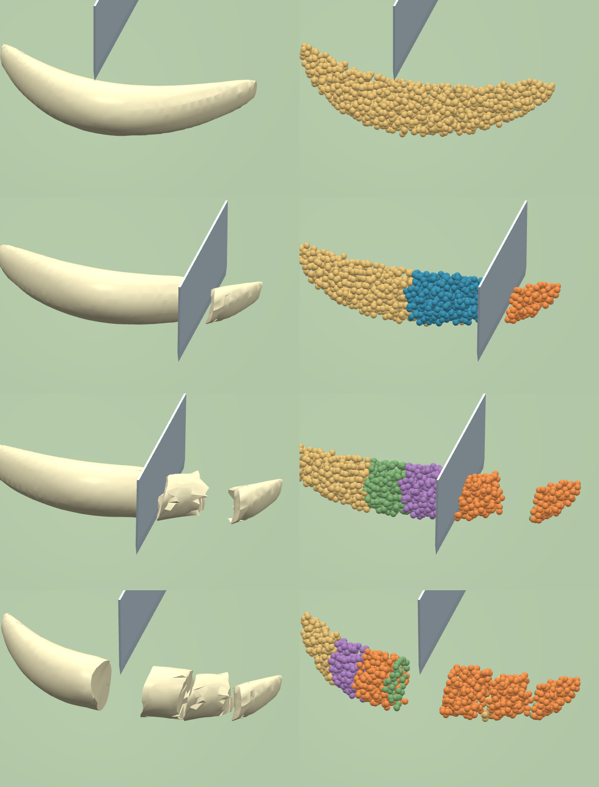

第二刀以后，中间几块的表面出现翅片和尖刺，而同一时刻的粒子是完整的块。原因在嵌入：表面顶点的位置取自周围编号相容的粒子，编号 0 与两侧都相容。材料按论文 \(h_k = 6\Delta x\) 的宽带给粒子分配侧别，表面却只给被切断连接的两端节点分配，切口附近的外皮节点一直是 0，于是按两块的平均运动移动；块被推开后就被拉成翅片。

修复（`surface.py`）：

1. 表面节点按与材料相同的规则（横向 \(\le 6\Delta x\)、刚被刀刃扫过）分配侧别。
2. 两端在同一刀上分别为侧别 1 和 2 的连接一律视为切断，交点按两端到刀面的有符号距离插值。没有这一条时，个别被扫掠检测漏掉的连接会让一个区域同时带两种侧别，顶点仍跟随两块。

修复后同一任务（6 mm 网格，`runs/fig1_fast`）：

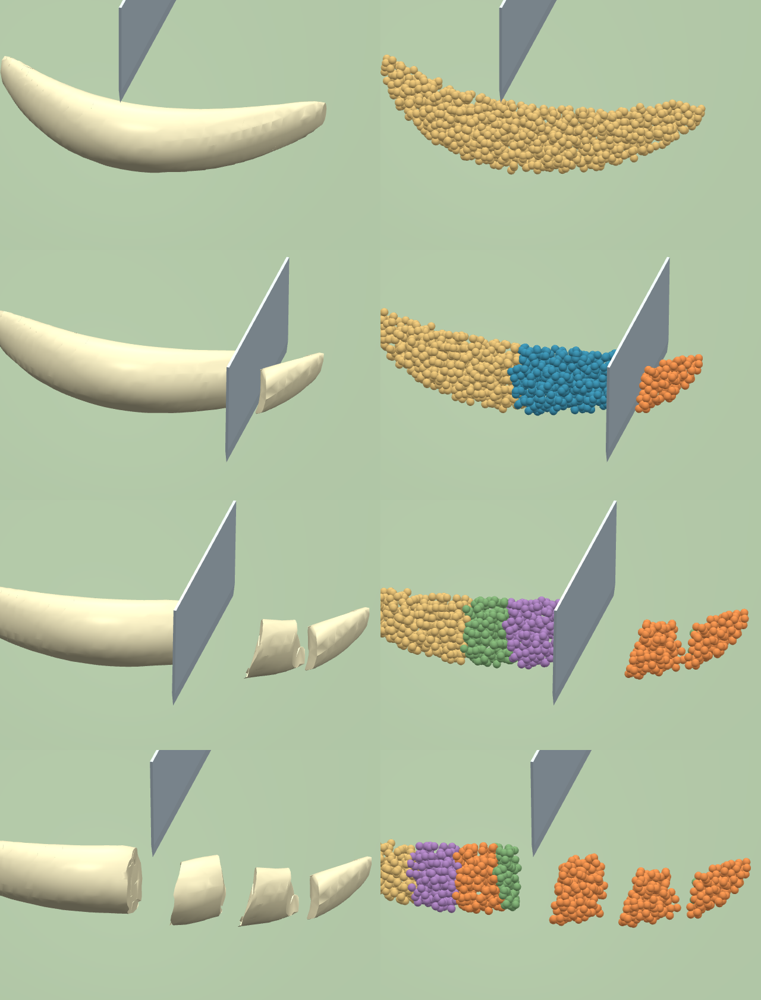

整臂回放（[视频](media/fig1_sequence.mp4)）：

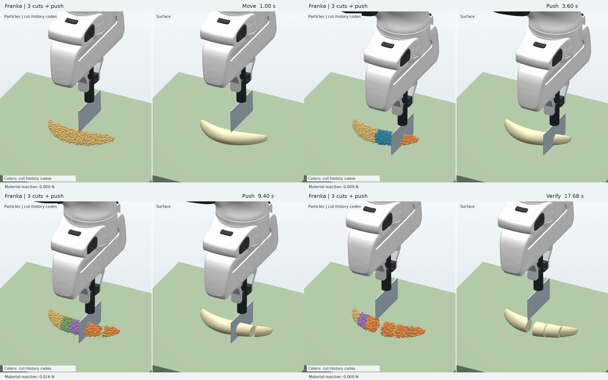

不带录制重跑：18.06 s 仿真用时 28.78 s（**0.628×**）；材料 19.6 s、观测与表面 6.3 s、机器人 2.4 s；4 块（779 / 302 / 220 / 138）。

## 2026-10-16 3 mm 网格的三刀切割

`--spacing 0.003 --dt 0.00003125`，其余同上；`runs/fig1_h3b/`。11485 粒子（6 mm 时 1439），表面间距 1.5 mm。

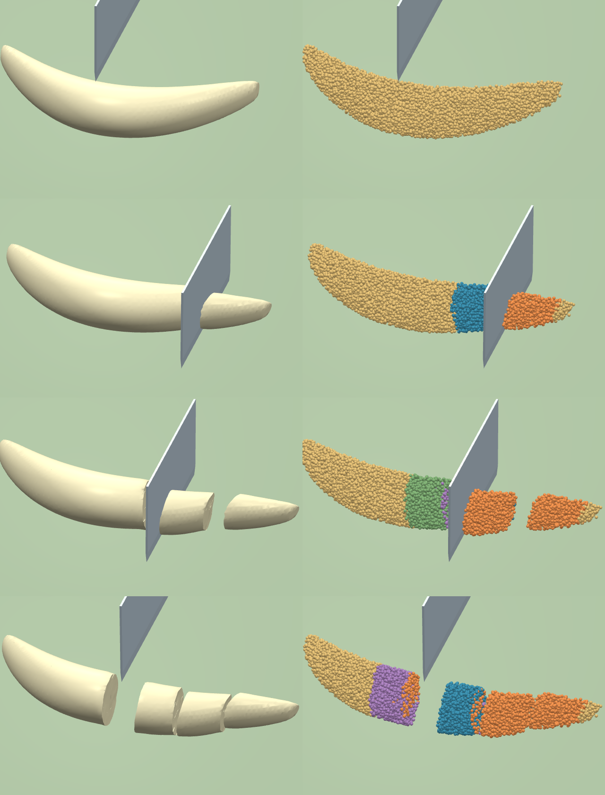

整臂回放（[视频](media/fig1_sequence_3mm.mp4)，2026-10-17 起为固定 0.5 mm 刀接触距离的重跑 `runs/fig1_h3c`，见下节）：

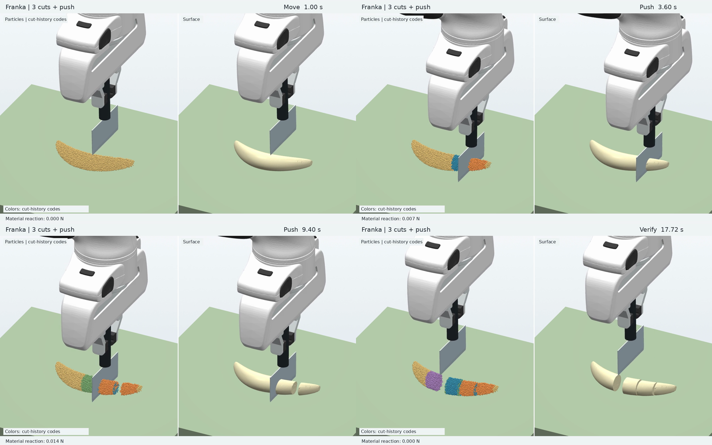

| 网格 | 粒子 | 分块（粒子数） | 峰值材料力 | 最小 det F | 仿真 / 用时 | 材料 | 观测+表面 |
|---|---|---|---|---|---|---|---|
| 6 mm | 1439 | 876 / 247 / 177 / 139 | 7.7 N | 0.93 | 19.5 s / 33.3 s（0.58×） | 19.8 s | 8.5 s |
| 3 mm | 11485 | 6701 / 2054 / 1678 / 1052 | 2.25 N | 0.91 | 17.8 s / 167.5 s（0.11×） | 132.5 s | 31.4 s |

两者都含逐帧记录。6 mm 时香蕉直径只有约 4 格，截面呈梯形、外皮发块；3 mm 下截面圆润，切面平整。峰值力随网格变化很大（6 mm 的 7.7 N 主要是触板尖峰），力的收敛仍待按论文 Fig. 9 的做法（20 次采样平均 + 加密）检查。

## 2026-10-17 多把自由刀；Fig. 6 未复现：软材料中 \(G_c\) 不进入切割力

**多刀**：`Config(tool_count=K, free_blade=True)`。刀状态数组长度为 K，刀 k 用切割码第 `cut_index + k` 位、自己的反力与刀—颗粒摩擦历史；`contact.blade_at` 从 `rigid_at` 拆出，单刀结果与拆分前的差别等于两次相同运行的 GPU 原子累加噪声（位置 1e-7 m）。测试（`tests/test_multi_tool.py`）：只允许自由刀；交换刀的编号结果不变；镜像放置的两把刀在碰到砧板前完全镜像（碰板后因刀—板逐顶点求解顺序不对称而略有差别，单刀已有的行为）；放在块外的刀严格自由落体。

**Fig. 6**（`python -m blademaster_warp.paper_impact`）：Fig. 8 的块与材料，三把 0.1 kg 刀在 x = −30/0/30 mm 以 0.5/0.8/1.1 m/s 竖直射入。三把刀都几乎不减速地切穿 42 mm 到达板面，与论文"被材料反力减速、速度越大越深"不符。排查：

1. 刀厚 1 mm、接触距离 0.5 mm 时，6 mm 网格下粒子列距 3 mm，刀落在两列之间就谁也碰不到（x = 0 和 30 mm 的刀正是如此）。改用粒子半径后仍然切穿；刀厚 3 mm、粒子抖动采样、刀质量 5–100 g 全部切穿。
2. 规定刀以 50 mm/s 下切同一块，竖直反力与 \(G_c\) 无关：\(G_c\) = 10、100、1000 J/m² 时都是 0.100 N（6 mm 网格）/ 0.030 N（3 mm 网格），而 \(G_c W\) = 0.5–50 N；没有一个粒子的损伤达到 1。

原因在式 (5)：功按 \(J_{c,p}\,u_{c,p}\) 累积，\(u_{c,p}\) 是刀刃相对粒子的推进速度。软材料里刃前粒子几步内就被推到与刀同速，\(u_{c,p}\) ≈ 0，功不增长；粒子随后从刃两侧滑过，一到刃后就按几何分配侧别而分离，切割能从未被支付。所以在这种软度下，\(G_c\) 与锋利度都不影响力。实现与论文式 (4)–(6) 一致；论文 Fig. 6 的减速可能依赖未写明的设置，或者这是该方法对软材料的限制。待定。

另：6 mm 香蕉配置的接触距离 0.5 mm 小于不漏碰的 \(\Delta x/4\) − 半厚 = 1.0 mm，已改，见下节。

## 2026-10-17 切割阻力的两个可选修改；6 mm 刀接触距离下限

### 刀接触距离下限

求解器把刀接触距离提高到至少 \(\Delta x/4\) − 刀半厚（原来只发警告）。香蕉 6 mm 配置由 0.5 mm 变为 1.0 mm；3 mm 及更细网格下限 ≤ 0.25 mm，仍为 0.5 mm，收敛结果不变。全部测试通过。

6 mm 三个视频重录（`runs/fig1_fast3`、`runs/grasp6d`、`runs/teleop6d`，命令同前）：三刀 4 块（763 / 312 / 223 / 141），抓刀 4 块（797 / 278 / 223 / 141），遥操作仍为两道未切透的切口；无 GPU 错误，带录制 0.635×。第一刀切下的尖端在推开前外移 1.9–2.1 mm（上一版 1.3–1.9 mm），即刀的有效半厚 1.5 mm 加少量蠕动，最高瞬时 20 mm/s，切透后不再继续外移，没有"弹走"。

### 切割阻力：问题定位

规定刀以 50 mm/s 下切 Fig. 6 的块（100×50×42 mm，6 mm 网格，刀宽覆盖块宽 50 mm），统计刀正下方一带（\(|x| \le\) 半厚 + 接触距离，238 个粒子）中损伤达到 1 的数量：

| 材料 | 变体 | \(G_c\)=10 | 100 | 1000 J/m² |
|---|---|---|---|---|
| E 20 kPa，屈服 2 kPa | 论文式 (5) | 0.10 N，0 个 | 0.10 N，0 个 | 0.10 N，0 个 |
| | 按刀自身推进速度计功 | 0.10 N，0 个 | 0.10 N，0 个 | 0.10 N，0 个 |
| | 刃前粒子不得绕刃 | 0.29 N，204 个 | 1.95 N，12 个 | 1.95 N，0 个 |
| E 400 kPa，屈服 40 kPa | 论文式 (5) | 1.54 N，17 个 | 1.54 N，17 个 | 1.54 N，0 个 |
| | 刃前粒子不得绕刃 | 1.70 N，221 个 | 3.28 N，221 个 | 29.1 N，88 个 |

（表中为边缘深 12–32 mm 段的平均竖直力。）即使在香蕉的模量（400 kPa）下，论文式 (5) 的力也与 \(G_c\) 无关，几乎所有刀下粒子都在损伤未满时就从刃两侧滑过、按几何分配侧别而分离。所以香蕉预设的 \(G_c\) = 700 J/m² 目前同样不影响切割力。

原因不只是相对速度为零：侧别（断开连接）只按刀刃是否扫过来分配，与损伤无关；损伤只决定刃能否"压穿"粒子。粒子能滑到刃侧，就不需要被压穿。

### 两个开关（默认都关，即论文行为）

- `Config.cut_work="advance"`：式 (5) 的 \(u_{c,p}\) 改用刀刃自身沿切割方向的速度，而不是相对粒子的速度。单独打开几乎没有作用（上表），因为粒子照样绕刃滑走。
- `Config.cut_hold=True`：损伤未满、位于刃口正前方（\(|x| \le\) 半厚 + 接触距离，刃下或刃尖以上不超过同样距离）的粒子，刀只沿切割方向推它，法向取切割方向、距离取到刃线的距离，不能沿斜面或侧面滑开；损伤满 1 后恢复原来的接触并去掉切割方向分量（式 (6)）。侧别分配不变：两侧粒子照常分开，但刃前未断的粒子仍通过网格连接两侧，直到切割能付清。

`cut_hold` 下力随 \(G_c\) 增长：400 kPa 时比论文变体多出 0.16 / 1.74 / 27.5 N，大致正比于 \(G_c\)，即经典的稳态切割力 ≈ \(G_c\) × 宽度 + 摩擦。按阈值 \(G_c A (1-s)/s\)（锐度 s = 0.9）和刃前两列粒子估计应多出 0.11 / 1.1 / 11 N，同一量级；1000 J/m² 时一部分粒子直到触板都没断，力含压缩。20 kPa、屈服 2 kPa 的材料在 \(G_c \ge 100\) 时达到上限 1.95 N：材料先塑性流动、被刀推开，而不是断裂（\(G_c/\sigma_y\) = 5 cm，远大于粒子尺度），力不再随 \(G_c\) 增加。

测试（`tests/test_cut_resistance.py`，小块 400 kPa）：论文变体 \(G_c\) 从 100 到 1000 力不变（0.668 / 0.664 N）；`cut_hold` 下 0.92 → 6.48 N。

### Fig. 6 在两种变体下

`paper_impact --cut-hold [--cut-work advance] --knife-mass M --cutting-energy G`。统计改为用刀的姿态算刃的最低点（原来用刀中心减半高，刀倒下后会显示刃在板下 28 mm；实际是两侧刀碰板后倒在板上）。

- 0.1 kg 刀：论文变体下刀在块内以接近 g 加速（0.5 → 0.98 m/s）；`cut_hold`、\(G_c\) = 100 时基本匀速（0.5→0.6、0.8→0.75、1.1→1.09 m/s），阻力约等于刀重，仍然全部触板。\(G_c\) = 100/300/1000 轨迹完全相同（上面的塑性上限）。
- 30 g 刀（论文未给刀质量）：论文变体仍全部触板；`cut_hold`、\(G_c\) = 100 时三把刀停在不同深度，速度越大越深（10 / 16 / 29 mm），与 Fig. 6 定性一致；但停住后刀下未断的材料像压缩弹簧一样回弹，把两把较轻的刀弹出块外。论文中刀停在材料里。

结论：论文式 (5) 原样实现时，切割能在软材料和香蕉模量下都基本不起作用；`cut_hold` 让 \(G_c\) 以正确的量级进入切割力，但改变了未切断材料对刀的作用，Fig. 6 中会出现回弹，香蕉 \(G_c\) = 700 时的力未测，按上表比例估计为数 N 到十几 N（Franka 刚度 1000 N/m 下需要重新检查能否切透）。默认保持论文行为。

## 2026-10-17 论文 Fig. 7（刀尖十字划痕）与 Fig. 8（连续薄切）

`python -m blademaster_warp.scenarios --scenario fig7-shallow|fig7-deep|fig8 --surface --surface-embedding cuda --surface-ccd cuda`；图 `python -m scripts.scene_surfaces ...`（Fig. 7 用 `--surface-spacing 0.0025`）。两者都是规定刀路（论文用 Franka），\(G_c\) = 10 J/m² 为本地取值。

**Fig. 7**：块 80 × 80 × 70 mm，1 cm 网格，3584 粒子（与 Table I 相同）；E = 6 kPa、ν = 0.35、ρ = 1100（论文）。刀绕厚度轴倾斜 30°，最低的刀角在前，先沿 x、再沿 y 各划 60 mm。重力下顶面先沉降到 66.5 mm（6 kPa 很软，\(\rho g H^2/2E\) ≈ 4.4 mm），深度从沉降后的顶面算：浅 6 mm、深 20 mm。两次都保持一块（不切透）；浅划只切开顶层粒子（粒子间距 5 mm），表面上是细痕；深划切开 4 层，表面是明显切口，两刀在中心相交。

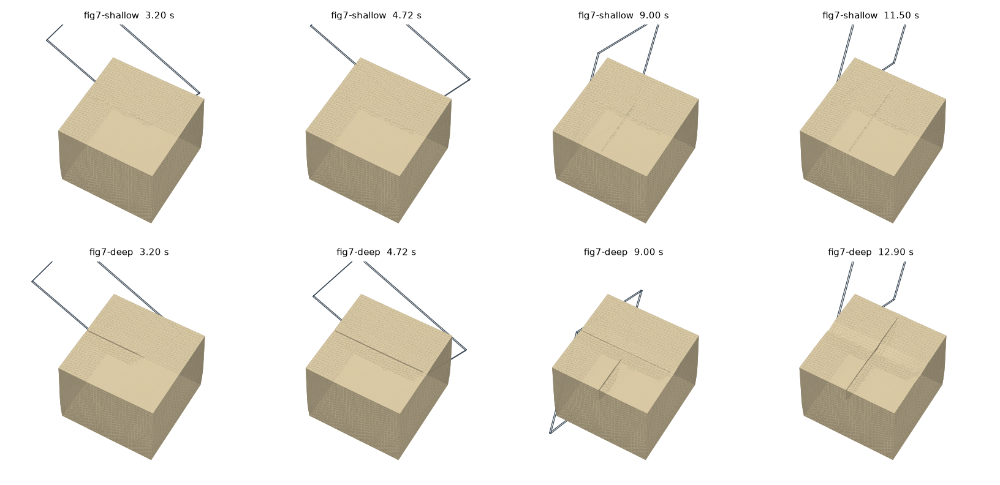

**Fig. 8**：块 100 × 50 × 42 mm，6 mm 网格，7854 粒子（Table I 7922）；Fig. 6 材料 E = 20 kPa、ν = 0.4、ρ = 1200、屈服应力 2 kPa（论文）。从 +x 端每隔 12 mm 切一刀，共 4 刀；刀接触距离用粒子半径 1.5 mm（0.5 mm 时刀正好落在两列粒子之间、谁也碰不到，见下面 Fig. 6 一节）。每刀切到板后刀升到顶面下 12 mm 再向外推 20 mm 帮助倾倒（论文未说明薄片如何倒下）。结果：4 片各 952 粒子；第 1 片在刀推之前、底部刚切开时就自己向外倒下，落地后滑约 20 mm（落地水平速度约 0.3 m/s、动摩擦 0.2 时 \(v^2/2\mu g\) ≈ 23 mm）后静止；最终倾角 90°、84°、61°、42°，后两片斜靠在前一片上，形成叠堆。

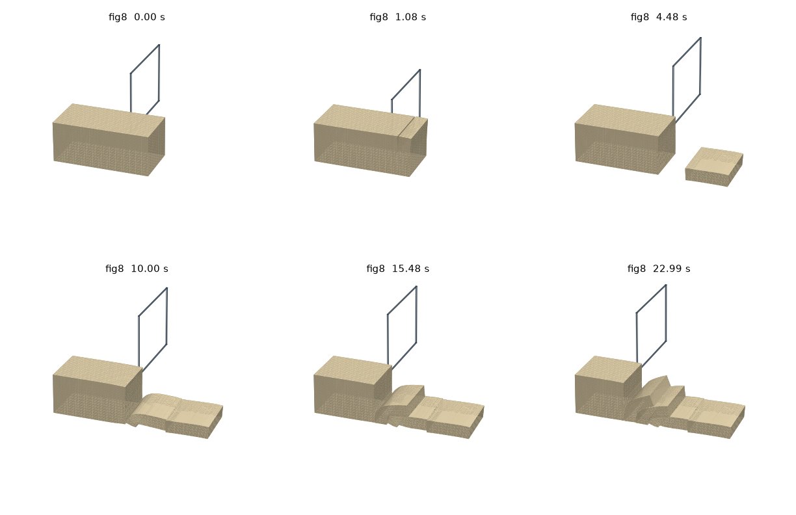

## 2026-10-17 Table I 计时（RTX 4060，只计 `ExternalToolPort.advance`）

| 场景 | 粒子 | 0.5 ms，\(s_n\) = 0.1 | 论文步长，\(s_n\) = 0.1 | 论文步长，\(s_n\) = 1（现默认） | 论文（RTX 5090） |
|---|---|---|---|---|---|
| 重力刀（Fig. 3） | 8960 | — | 0.47（2 ms） | — | 0.33 |
| 中间片抬升（Fig. 4） | 8932 | 0.49 | 0.21（2 ms，片未切开） | 0.216（2 ms，片抬 38.6 mm） | 0.36 |
| 刀尖划痕（Fig. 7） | 3584 | 0.36 | 0.17（2 ms） | 0.17（2 ms） | 0.30 |
| 连续薄切（Fig. 8） | 7854 | 0.49 | 0.30（1 ms，4 片只切开 2 片） | 0.30（1 ms，4 片全切开） | 0.56 |
| 多刀冲击（Fig. 6） | 7854 | 0.63（3 把自由刀） | — | — | 0.62 |

论文步长下 \(s_n\) = 0.1 的问题来自每步罚函数：刚度 \(s_n m/\Delta t^2\)，柱高 N 个粒子时底层穿透约 \(N g \Delta t^2/s_n\)，在 1–2 ms 达到 1.4–4.3 mm，最底层落到刀刃以下而切不开；Fig. 4 的平刀同样托不住片。改为 \(s_n\) = 1（砧板与刀接触都是）后三个场景在论文步长下都得到与 0.5 ms 相同的结果，场景默认已改为论文步长，见文末"大步长下的接触"。

## 2026-10-17 论文 Fig. 4：中间片抬升与单场对照

`python -m blademaster_warp.scenarios --scenario fig4 [--single-field]`，对比图 `python -m scripts.fig4_compare runs/fig4_bm runs/fig4_sf --output ...`。

- 圆柱直径 160 mm、高 56 mm，1 cm 网格，8932 粒子（Table I 8960）；E = 10 kPa、ν = 0.4、ρ = 1100（论文）。刀长 100 mm、高 80 mm，两刀径向切在 ±60°（120° 扇形片），每刀越过轴线 10 mm 使两刀在顶点重叠。刀路为规定位姿（论文用 Franka）；\(G_c\) = 10 J/m² 为本地取值（论文未给，规定刀路下只影响切开前的变形）。
- 抬升：刀放平、刃朝轴线，在圆柱外转向后贴着砧板滑入（刀顶面与板面齐平；规定刀不与板碰撞），只在扇形片下方（\(|y|<50\) mm 在 \(x>29\) mm 处都在片内），再抬 40 mm。
- 单场对照按论文：刀不在切割时，粒子—网格传递忽略切割码（`Solver.set_single_field`）；切割码分配与粒子接触不变，所以两者的分块完全相同（5940 / 2992）。

| | 片的抬升 | 其余材料（最大 / 95% 分位） |
|---|---|---|
| BladeMaster | 38.7 mm（刀抬 40 mm） | 0.1 / 0.0 mm |
| 单场对照 | 3.9 mm，之后刀从片中穿过 | 2.9 / 1.4 mm |

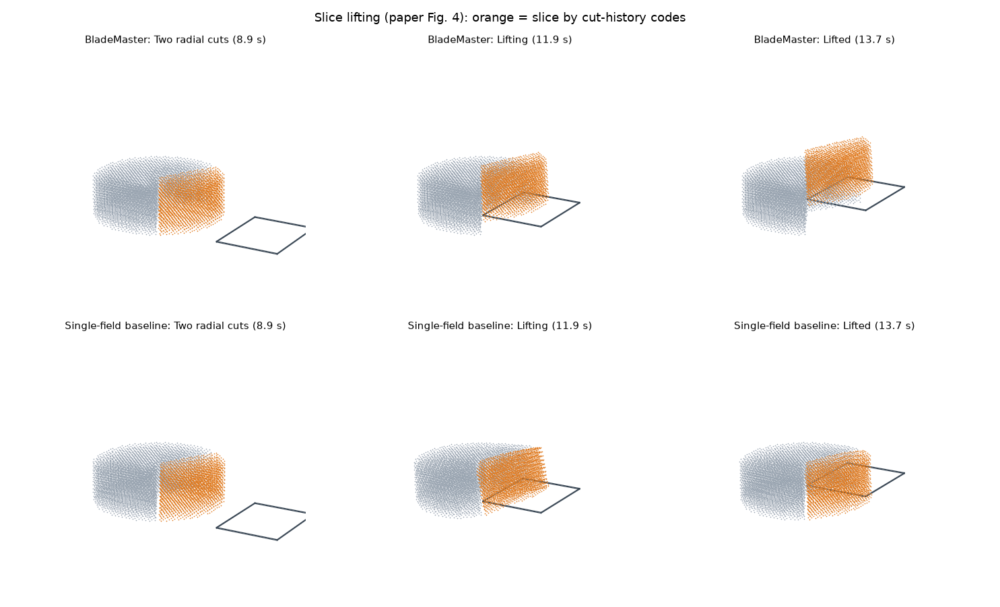

单场下片与其余部分经共享节点粘在一起，刀托不起整体，片被抬起少许后刀从材料中穿出；论文图中是周围材料被一起带起，失败形式不同但原因相同。

调试中发现的两个问题（都已在场景设置中处理）：

1. **2 ms 步长下底层没有被切开。** 砧板接触是每步罚函数，刚度 \(s_n m/\Delta t^2\)；底层粒子承受约 11 个粒子的柱重，平衡穿透约 \(11\,g\,\Delta t^2/s_n\) ≈ 4.3 mm，实测底层从 2.5 mm 沉到 −1.1 mm，低于停在 0.4 mm 的刀刃，于是最底下一层始终没有分配侧别，片在底部与其余部分相连（逐对检查跨切线的相容粒子对，全部位于 2.5–10 mm 高度）。场景默认步长改为 0.5 ms（估计穿透 0.27 mm）。
2. **0.5 mm 刀接触距离下平刀托不住片。** 粒子间距 5 mm，粒子最多被压入 1 mm（刀半厚 + 接触距离）就越过刀的中面、被反向推下；刀上平均只承受 1–2 N（片重 4.0 N）。粗网格改用粒子半径 \(\Delta x/4\) = 2.5 mm（代码默认值）。香蕉细网格仍用固定 0.5 mm。

Table I 计时（只计 `ExternalToolPort.advance`，不含保存与渲染，RTX 4060）：2 ms 步长 0.214 wall/sim（论文 0.36，RTX 5090），但此时片未切开；能切开的 0.5 ms 为 0.49。后来砧板与刀的每步罚因子改为 1，2 ms 下片切开并抬起 38.6 mm（0.216 wall/sim），场景默认已改回 2 ms，见文末。

## 2026-10-17 切下的块被挤出（"弹走"）

旧的 3 mm 录制（`runs/fig1_h3b`）里，第一刀（x = 40 mm）切下的尖端在刀触板前最后 0.25 s 外移 2.1 mm（最高 15 mm/s），到切透时累计 3.25 mm，之后推开阶段才是设计的 12 mm 平移。刀的横向偏差只有 0.27 mm，不是刀被推歪。原因是刀—粒子接触距离取 \(h/4\)：3 mm 网格上刀的有效厚度为 1 + 1.5 = 2.5 mm，刃口楔形把近不可压（ν = 0.45）的材料挤向两侧，最后韧带断开时弹性能释放。

规定刀路竖直切同一位置（3 mm，两个采样种子平均），切透后尖端外移：

| 接触距离 | 摩擦 | 外移 |
|---|---|---|
| \(h/4\) | 0.2 | 1.89 mm |
| 0.5 mm | 0.2 | 1.00 mm |
| 0.5 mm | 0.5 | 1.21 mm |
| 0.25 mm | 0.5 | 0.96 mm |

固定 0.5 mm 后外移等于刀半厚 + 接触距离，切透后不再继续移动；粒子—板摩擦影响很小。Franka 三刀用当前默认值重跑（`runs/fig1_h3c`，dt 40 µs）：切透时外移 1.61 mm、推开前回落到 1.32 mm（旧录制 3.25 → 3.57 mm）；4 块（6102 / 2418 / 1886 / 1079），峰值材料力 1.05 N（旧 2.25 N），带录制与表面 17.7 s / 115.7 s（0.153×）。

6 mm 的三个视频（三刀、抓刀三刀、遥操作模拟输入）也按原参数重录（`runs/fig1_fast2`、`runs/grasp6c`、`runs/teleop6c`）。三刀与抓刀均为 4 块（754 / 301 / 245 / 139），遥操作仍为两道未切透的切口。6 mm 下旧录制的外移本来就小（0.8–1.2 mm，粒子间距大于刀厚，刀挤进粒子之间）；新录制切透后 0.15 s 内外移 1.2–1.7 mm（刀身继续下行挤过切口）后停住。

## 2026-10-16 合并 kernel：没有收益，已撤回

把刚体接触与网格清零合并、形变更新与侧别分配合并，在同一台机器上测子步耗时（`scripts/probe_substep.py`，各测两次）：

| 网格 | 合并前 | 合并后 |
|---|---|---|
| 6 mm，1439 粒子 | 60.4 / 60.5 μs | 65.1 / 60.3 μs |
| 3 mm，11485 粒子 | 227.8 / 227.7 μs | 228.1 / 226.4 μs |

子步已整段在 CUDA graph 里，kernel 之间的启动间隔约 1 μs；耗时来自每个 kernel 自身的延迟（单线程的 `finish_external_step` 也要 3 μs；刚体接触中所有粒子对同一地址做原子累加）。把接触对表的清零也并入 kernel 反而更慢（3 mm 下 126 μs，原生 memset 只要几微秒）。代码已撤回（`2b6ffc8`）。

## 2026-10-16 表面 CPU 开销

三刀序列（6 mm，带记录）：

| | 网格构建 | 观测+表面 | 实时倍率 |
|---|---|---|---|
| 修复尖刺后、优化前 | 7.43 s | 14.1 s | 0.49× |
| 优化后 | 2.03 s | 9.0 s | 0.585× |

改动：边周围格子的角度顺序只取决于参考网格，改为初始化时算一次（原来每次重建都对每条边做 `arctan2` 排序）；节点到格子的索引表代替遍历全部格子；格子内被切断的连接不变时复用上次的 QEF 点，只重算区域编号（侧别带每帧会改变很多节点的编号，但不改变几何）。

## 2026-10-16 香蕉：步长、接触对表、连通块、顶点嵌入

### 3 mm 网格的步长

香蕉 P 波速 \(c=\sqrt{E(1-\nu)/((1+\nu)(1-2\nu))/\rho}\approx 37\) m/s，3 mm 网格的 \(\Delta x/c\approx 81\) μs。单刀（`--cuts 0.02`，8 s，带记录）比较三档步长：

| 步长 | 网格 CFL | 分块 | 峰值材料力 | 最小 det F | 材料用时 | 切后 5–6 s 残余最大速度 |
|---|---|---|---|---|---|---|
| 31.25 μs | 0.39 | 8348 / 3137 | 2.31 N | 0.880 | 41.2 s | 1.8 → 1.1 mm/s，衰减 |
| 41.7 μs | 0.52 | 8325 / 3160 | 2.11 N | 0.904 | 31.5 s | 7.7 → 6.7 mm/s，衰减 |
| 62.5 μs | 0.77 | 8368 / 3117 | 2.18 N | 0.896 | 21.5 s | 5.3 → 13.5 mm/s，动能 0.05 → 0.24 μJ，增长 |

与 31.25 μs 相比，刀具 z 向力逐毫秒的均方根差：41.7 μs 为 0.091 N，62.5 μs 为 0.101 N；同一步长只换采样种子为 0.04–0.18 N，步长带来的差别在采样差别以内。62.5 μs 下切后动能不衰减，判为接近稳定边界，不采用。

`franka_run` 的香蕉默认步长改为 \(\min(62.5\,\mu s,\ 0.5\,\Delta x/c)\) 并向下取到整除 1 ms：6 mm 仍为 62.5 μs（受接触刚度限制），3 mm 为 40 μs。原来只给 `--spacing 0.003` 时默认用 62.5 μs，正落在上面不稳定的一档。

### 其他改动

- 接触对哈希表：原来每个子步把整张表（按每粒子 64 对预留，3 mm 下 8 MB）填 −1；改为记录本步写入的槽位，复用前只清这些。3 mm 子步 228 → 214 μs；6 mm 不变（60–61 μs）。
- 连通块（每次快照、侧别变化时计算）：Python 并查集改为 scipy 稀疏图连通分量，结果逐元素相同；3 mm 下每次 105 → 5 ms。
- GPU 顶点嵌入：原来每种侧别各上传一次粒子数据、对全网格求一次场、读回一次；改为一个 kernel 内每个顶点按自己的侧别求 8 个角点。与 CPU 实现逐顶点一致（误差 1e-12）。
- 试过：刚体接触中先读后比较、只在可能刷新最大值时做 `atomic_max`，无可测收益，已撤回。

### 三刀序列（不录制，含表面）

| 网格 | 分块 | 仿真 / 用时 | 材料 | 观测+表面 | 其中网格构建 / 顶点嵌入 |
|---|---|---|---|---|---|
| 6 mm，此前 | 779 / 302 / 220 / 138 | 18.06 s / 28.78 s（0.628×） | 19.6 s | 6.3 s | — |
| 6 mm，现在 | 794 / 284 / 221 / 140 | 18.10 s / 27.5 s（**0.659×**） | 20.1 s | 4.55 s | 2.25 / 0.81 s |
| 3 mm，31.25 μs（带录制） | 6701 / 2054 / 1678 / 1052 | 17.8 s / 167.5 s（0.11×） | 132.5 s | 31.4 s | — |
| 3 mm，40 μs，仅改步长 | 6739 / 2008 / 1686 / 1052 | 17.76 s / 126.1 s（0.141×） | 97.6 s | 25.1 s | 7.30 / 4.04 s |
| 3 mm，40 μs，现在 | 6720 / 2028 / 1685 / 1052 | 17.77 s / 114.0 s（**0.156×**） | 97.8 s | 12.9 s | 7.15 / 1.59 s |

分块大小的小差异来自浮点原子累加顺序。3 mm 下材料计算占 86%，其中最大的一项是粒子对接触（每子步约 61 μs，主要是对邻居的查询本身）。

## 2026-10-17 夹爪、抓刀与 Franka 遥操作

### 固定安装

刀是 `hand` 的子刚体，装在安装座圆柱（半径 8 mm）下方。原来手指张开 35 mm，看起来像没夹住；现在手指合到 8 mm、贴在安装座上。手指与刀、安装座之间无接触（1.5 s 静止检验），末端跟踪不受影响。

### 抓刀（`--attachment grasp`）

刀是带柄的自由刚体，只靠手指摩擦保持，没有焊接约束。三刀序列（6 mm，带记录）中刀相对手的滑动：

| 设置 | 结果 | 滑动（最大 / 最终） | 转角最大 | 最大跟踪误差 |
|---|---|---|---|---|
| 每指 10 N，MuJoCo 默认接触 | 4 块 | 16.7 / 13.8 mm | 11.3° | 18.9 mm |
| 每指 30 N，默认接触 | 4 块 | 10.9 / 10.9 mm | 4.5° | 13.5 mm |
| 每指 30 N，椭圆摩擦锥、`impratio=10`、noslip 5 次 | 4 块（875 / 248 / 177 / 139） | **1.5 / 1.5 mm** | **0.17°** | 4.7 mm |
| 固定安装（对照） | 4 块 | — | — | 8.3 mm |

不切割时也会滑：静止 2 s 内刀在自重下下滑约 6.5 mm，与夹持力关系不大，是 MuJoCo 默认软摩擦约束的蠕滑（金字塔锥、`impratio=1`）。手指摩擦系数 1.0，30 N/指的摩擦容量远大于刀重 1.3 N。改刀柄 `solref`/`solimp` 反而增加初始嵌入（约 4 mm），未采用。抓刀模式现在默认使用最后一行的设置；noslip 使机器人步进从约 2 s 增至 5.5 s（18 s 仿真）。

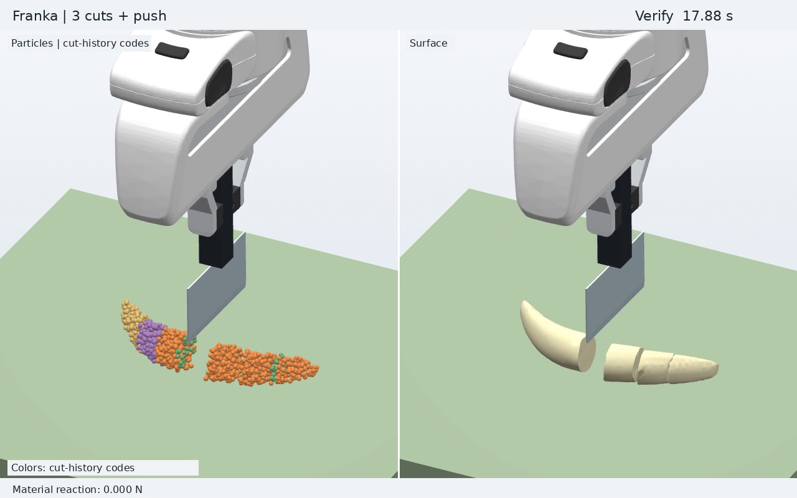

[视频](media/fig1_sequence_grasp.mp4)

### Franka 遥操作（`--motion teleop`）

每个 1 ms 机器人步读取最新的刀具线速度、角速度和事件，积分成刀的目标位姿，按当前测得的刀—TCP 相对位姿换算成 TCP 目标交给阻抗控制器。`begin_cut` 开新的一刀（新的切割码位），`end_cut` 关闭切割；在线界面的 `/input` 与独立刀遥操作同一协议，`spacemouse_client` 无需修改即可连接。

不带 `--live` 时使用固定模拟输入：两次下刀各 36 mm（刀刃最低离板 4.5 mm），中间平移 3 cm 并扭转约 6°。结果是两道未切透的切口、仍为一块（6 mm，0.56× 实时，带表面和记录）。切口只出现在刀实际经过的位置。

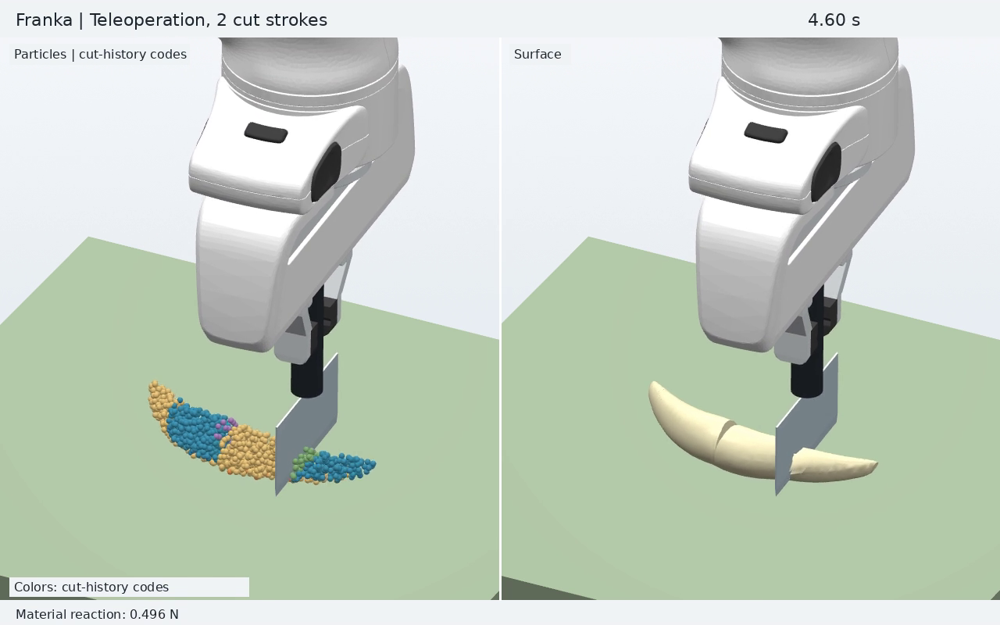

[视频](media/franka_teleop_mock.mp4)

libfranka 示例的转动增益（10 Nm/rad，阻尼 \(2\sqrt{k}\)）时间常数约 0.6 s，0.2 rad/s 的扭转会滞后几度，停止后收敛。

## 2026-10-17 任意网格间距、自动分刀、int64 切割码、统一刀—板接触

**网格间距**：`--spacing` 可取任意值。格数改为向上取整，网格总能覆盖整根香蕉（原来要求整除，4 mm 这类间距会被配置校验拒绝）。6 mm、3 mm 的粒子数不变（1439、11485）。

**切割码**：三进制切割码由 int32 改为 int64。哈希键是 `码 × 节点数 + 节点`，上限按 \(3^{k+1}\cdot\)节点数 \(< 2^{63}\) 计算：香蕉 6 mm 网格 33 刀，3 mm 31 刀，2 mm 30 刀（原来 19 刀）。大码使哈希的有符号乘法溢出成负槽位，改为无符号运算；表面重建的 19 刀上限同步改为 39 位。

**自动分刀**（`franka_run --motion teleop --cut-events auto`）：切割一直开启，刀离开材料后再进入就开始新的一刀，切割码在离开时就换好。判据是刀身旁（切割带内、刃口以上）是否还有粒子，不用接触力：刀从自己的切口退出时，切口张开，接触力常常恰好为零而刀还在材料里。用接触力判断时，同一条刀路（x = −25 mm 切透、抬刀、x = +25 mm 切透）被数成 3 刀，并有 543 个粒子在第二刀开始前就被标上了第二刀的码（一个码位对应两个切面）；按刀是否嵌入判断为 2 刀、0 个误标，切成 3 块。用刀面推开切块时仍应使用按键模式。

**刀—板接触**：原来导向刀用"刀心不低于半个刀高"的硬止挡（无摩擦、无姿态），位姿伺服刀和自由落体刀用 `tool.step` 的刀顶点—平面接触，Franka 用 MuJoCo。现在导向刀也走 `tool.step`（锁定转动；平移驱动本来就相同），三种内部刀共用同一个刀顶点—砧板接触（速度约束 + 库仑摩擦），并使用与粒子、MuJoCo 相同的有限砧板矩形；Franka 的刀—板接触仍由 MuJoCo 负责。

另外发现：`paper_experiments --driver guided` 用的 DexLab 驱动参数（250 N/m、限力 10 N）推不动论文材料的香蕉，刀刃停在离板约 20 mm 处，从未切开；改动前后结果相同（峰值 5.01 N），与刀—板接触无关。原因是纯比例驱动的稳态误差 \(F/k\)：约 5 N 阻力在 250 N/m 下就是 20 mm。已修复，见文末。

## 2026-10-17 表面重建提速与精度

3 mm 三刀录制（`runs/fig1_h3b`，445 帧、17.8 s 仿真）回放，CUDA 嵌入与 CUDA 碰撞检测：

| 阶段 | 原来 | 现在 |
|---|---|---|
| 网格构建（区域、QEF、三角形） | 9.7 s（含 cProfile 开销；无开销约 5.2 s） | 1.5 s |
| 参考网格建立（一次） | 3.5 s | 0.1 s |
| 表面总计（不含建立） | 11.6 s | 7.3 s |

- 顶点和三角形的组装改成按格子存放区域（每格最多 8 个）后用 numpy 一次生成，顺序与原来相同；三角形与改动前逐帧一致。
- 有界 QEF：三个未知量的箱约束最小二乘，最优解中每个坐标要么自由要么在某一边界上，枚举 27 种组合即得精确解。原来的 SciPy `lsq_linear`（tol 1e-10）在这些米制小问题上提前停止：2100 次有界求解中 2076 次残差高于精确解，因此约 40% 的表面顶点（香蕉表皮处）位置改变，最多一格（1.5 mm），三角形不变。
- 参考网格建立：连杆、Hermite 二分、格子与连杆表全部向量化；拓扑表与原来完全相同，Hermite 数据差 \(<6\times10^{-12}\)。
- 剩余：节点/顶点嵌入约 4 s，主要是 GPU→CPU 拷贝（测量时 GPU 同时在跑收敛研究，需重测）；切割扫掠 1.5 s；`MaterialEmbedding` 建立 3.8 s。

精度（`scripts/surface_accuracy.py`）：参考构形下做贯穿切割，每个顶点按自己的切割码属于某一块，真值是香蕉水平集与各切面半空间的交。顶点处水平集的绝对值（以表面格距为单位）：

| 情形 | 表面格距 3 mm：平均 / 最大 | 1.5 mm：平均 / 最大 | 网格闭合 |
|---|---|---|---|
| 未切 | 0.039 / 0.32 | 0.020 / 0.42 | 是 |
| 两道竖切 | 0.035 / 0.32 | 0.018 / 0.42 | 是 |
| 斜切（法向倾斜 0.5 rad） | 0.038 / 0.32 | 0.019 / 0.42 | 是 |
| 6 mm 薄片 ×2 | 0.035 / 0.32 | 0.017 / 0.42 | 是 |
| 3 mm 薄片 ×3 | 0.034 / 0.32 | 0.017 / 0.42 | 是 |

最大误差在所有情形相同，来自香蕉两端的尖头，不是切口。3 mm 薄片在 3 mm 表面格距下只有一格厚，仍然闭合、误差不变。这里不含材料变形（嵌入误差）和自交检查。

## 2026-10-17 切削力随网格的收敛（论文 Fig. 9 做法）

`scripts/force_convergence.py`：香蕉中部竖直切透（20 mm/s，刀刃从离板 36 mm 处下到板面，保持 0.2 s），每种网格用不同粒子采样重复，比较 0.4–1.4 s 时间窗内的平均竖直力（冲量同理）。步长按网格取 `banana_dt`，接触刚度按参考步长固定。

| 网格 | 粒子 | 采样次数 | 刀接触距离 \(h/4\)：平均力 | 固定 0.5 mm：平均力 | 固定 0.5 mm：冲量 |
|---|---|---|---|---|---|
| 6 mm | 1439 | 20 | 2.205 ± 0.334 N | 0.275 ± 0.074 N | 0.361 Ns |
| 5 mm | 2504 | 20 | 1.879 ± 0.190 N | 0.346 ± 0.076 N | 0.465 Ns |
| 4 mm | 4883 | 20 | 1.477 ± 0.119 N | 0.439 ± 0.057 N | 0.581 Ns |
| 3.5 mm | 7267 | 20 | 1.294 ± 0.090 N | 0.488 ± 0.042 N | 0.641 Ns |
| 3 mm | 11485 | 20 | 1.073 ± 0.047 N | 0.551 ± 0.033 N | 0.724 Ns |
| 2.5 mm | 19900 | 10 | 0.807 ± 0.024 N | 0.570 ± 0.018 N | 0.754 Ns |
| 2 mm | 38896 | 5 | 0.635 ± 0.011 N | 0.635 ± 0.011 N | 0.829 Ns |
| 1.5 mm | 92233 | 3 | — | 0.646 ± 0.005 N | 0.832 Ns |

全部切透，无 GPU 错误。

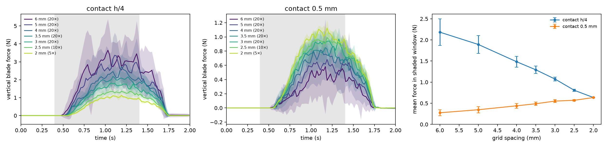

原来粒子与刀的接触距离是粒子半径 \(h/4\)，刀的有效厚度是 1 mm + \(h/2\)，随网格变化（6 mm 时 4 mm，2 mm 时 2 mm），稳态力随之近似线性变化，从 6 mm 到 2 mm 降为 1/3.4，不收敛；采样间的离散随加密减小，说明这是系统性的分辨率依赖而不是噪声。断裂能部分与 \(h\) 无关（每个粒子的阈值 \(G_c V^{2/3}(1-\zeta)/\zeta \propto h^2\)，每个粒子在切面上占 \((h/2)^2\)）。

香蕉预设改为固定 0.5 mm（`Config.blade_contact_radius`；粒子之间、粒子与砧板仍用 \(h/4\)）。2 mm 时两者相同。固定后从 2 mm 到 1.5 mm 平均力只变 1.7%、冲量 0.4%：3 mm 偏低约 15%，6 mm 只有收敛值的约 43%，且波动大——6 mm 下粒子间距 3 mm 大于刀厚，刀刃会挤进粒子之间（不切割的压入试验也是如此，见下）。Franka 三刀序列（6 mm）在新设置下仍切成 4 块、任务成功，峰值力 2.0 N（原 7.7 N）。

压入（不切割，压入 6 mm，3 次采样，`scripts/indentation.py`）：6 mm 0.80 ± 0.59 N，4 mm 1.86 ± 0.68 N，3 mm 2.16 ± 0.17 N，2 mm 2.13 ± 0.01 N。没有体积锁死使粗网格变硬的迹象；3 mm 已收敛。

牛顿黏性 0、2、5、20、50 Pa·s（3 mm，`scripts/viscosity_feel.py`）：稳态力 0.547–0.559 N，基本不变；退刀后 50 ms 材料均方根速度 1.0–1.25 mm/s，1 s 后都是 0.1 mm/s。无黏性时切块也几乎不晃，加牛顿黏性没有可见作用。

刀接触距离下限（\(\Delta x/4\) − 半厚，见上文）在 6 mm 与 5 mm 网格上生效（1.0 / 0.75 mm），重测 20 次采样：6 mm 1.164 ± 0.200 N（冲量 1.528 Ns），5 mm 0.788 ± 0.098 N（1.037 Ns），全部切透。收敛值 0.646 N，6 mm 由原来的 43% 变为 180%，5 mm 由 54% 变为 122%；4 mm 及更细不受影响。粗网格两头都不准：低于下限时刀从两列粒子之间滑过，取下限时刀的有效厚度（6 mm 下 3 mm）等于粒子间距，多挤开一列粒子。Franka 三刀序列峰值力相应由 2.0 N 变为 4.0 N。3 mm 网格（85%）仍是在线运行精度与速度的折中点。

## 2026-10-17 导向刀驱动、连续切割的到底判定

**导向刀**：论文没有给导向驱动。论文材料香蕉的峰值切割力约 5 N，DexLab 的 250 N/m 比例驱动下刀滞后 20 mm，到 2 s 退刀时刀刃仍在板上 13 mm。论文材料预设改为 1000 N/m（与 Franka 笛卡尔刚度相同）、对 0.1 kg 刀临界阻尼 20 N·s/m，限力仍 10 N；DexLab 基线不变。`paper_experiments --driver guided` 的单刀：250 N/m 一块不切开；1000 / 3000 N/m 切成 717 / 722，0.4–1.4 s 平均力 1.18 / 1.23 N（规定刀路 6 mm 为 1.164 N），峰值 4.2 / 4.5 N。`python -m blademaster_warp.run`（DexLab 三刀 + 推开，论文材料）：三刀刀心都到达板面（0.0200 m = 半刀高），最终 4 块 230 / 426 / 493 / 290，0.73× 实时。`paper_experiments` 新增 `--drive-stiffness`、`--drive-damping`、`--drive-force-limit`。

**`CutSequence` 到底判定**：原来只检查刀具原点；现在与单刀 `CutCycle` 相同，刀刃两端也必须在板面容差内，倾斜刀只有一角着板时不推开。6 mm Franka 三刀与抓刀序列重跑：都走完（`done`），4 块 763 / 312 / 223 / 141 与 797 / 278 / 223 / 141，与之前相同。

## 2026-10-17 大步长下的接触：砧板与刀的每步罚因子

论文 Eq. 11 的法向冲量 \(j_n = s_n m_e (-\text{预测间隙})/\Delta t\)，\(s_n\) < 1 时每步只消去一部分预测穿透。砧板不动、质量无穷，每个粒子只有一个砧板接触，可以取 1（每步消去全部预测穿透，相当于速度层面的硬约束）；新增 `Config.board_normal_scale`（0 = 沿用粒子接触的 \(s_n\)，默认；不随步长缩放）。2 ms 下 6 cm 高的块静置 1 s（`tests/test_board_contact.py`）：\(s_n\) = 0.1 时底层沉入板面 6.0 mm，取 1 时 0.3 mm。

只改砧板不够：Fig. 4 在 2 ms、砧板取 1 时片已切开（5940 / 2992，与 0.5 ms 相同），但刀只把片抬起 0.2 mm——片重通过同样软的刀接触把粒子压过平刀中面。刀接触 \(s_n\) 扫描（2 ms）：0.3 抬 0.3 mm，0.6 抬 9.5 mm，1.0 抬 38.6 mm（其余材料最大 0.5 mm，0.5 ms 时为 38.7 / 0.1 mm）。

Fig. 4 / 7 / 8 场景默认改为论文 Table I 步长（2 / 2 / 1 ms），\(s_n\) 与砧板因子都取 1。与原 0.5 ms 结果对照：

| 场景 | 0.5 ms，\(s_n\) = 0.1 | 论文步长，\(s_n\) = 1 |
|---|---|---|
| Fig. 4 片抬升 | 38.7 mm，其余 0.1 mm | 38.6 mm，其余 0.5 mm |
| Fig. 4 单场对照 | 片抬 3.9 mm 后刀穿出 | 片抬 0.2 mm（最大 1.1 mm）后刀穿出 |
| Fig. 7 深划 | 一块，切开 4 层（顶面下 15 mm） | 相同 |
| Fig. 7 浅划 | 一块，切开顶层 249 粒子 | 一块，切开 2 层 494 粒子 |
| Fig. 8 | 4 片，倾角 90° / 85° / 61° / 43° | 4 片，90° / 85° / 63° / 44° |

Fig. 7 浅划的差别：两次刀最低点都在 60.5 mm，第二层粒子在刃下约 2.5 mm，正好在接触距离（粒子半径 2.5 mm）边上，接触刚度不同就分到不同层；两者都是不切透的浅痕。香蕉预设不变（62.5 μs 下 \(s_n\) = 0.625，砧板穿透远小于 1 mm）。
