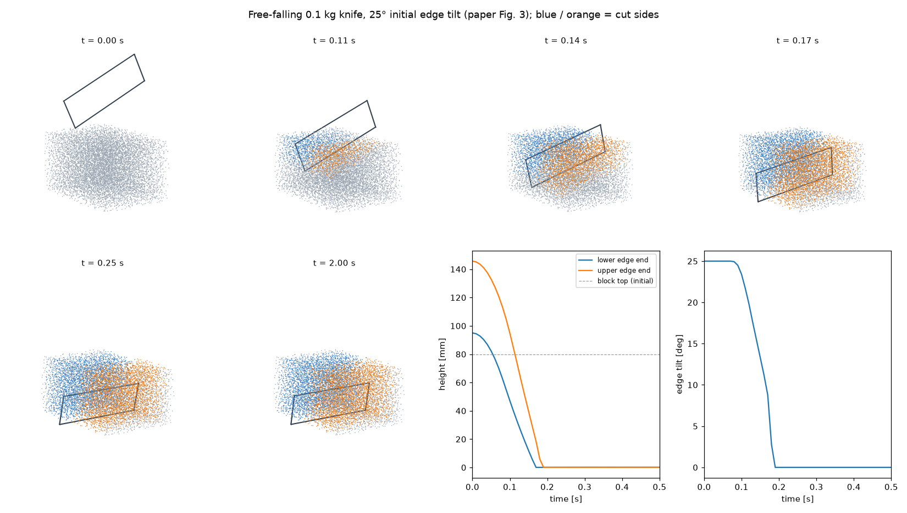
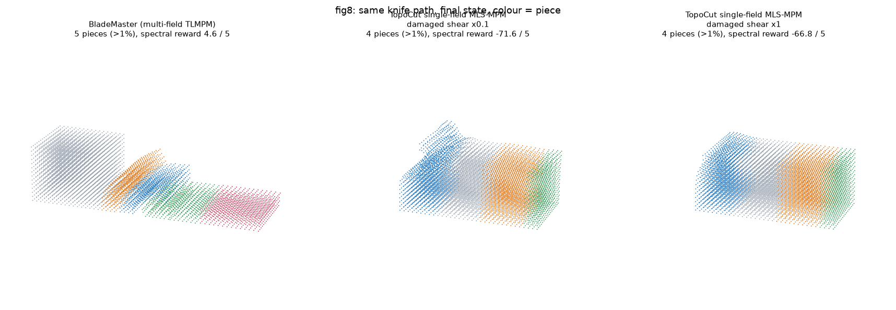
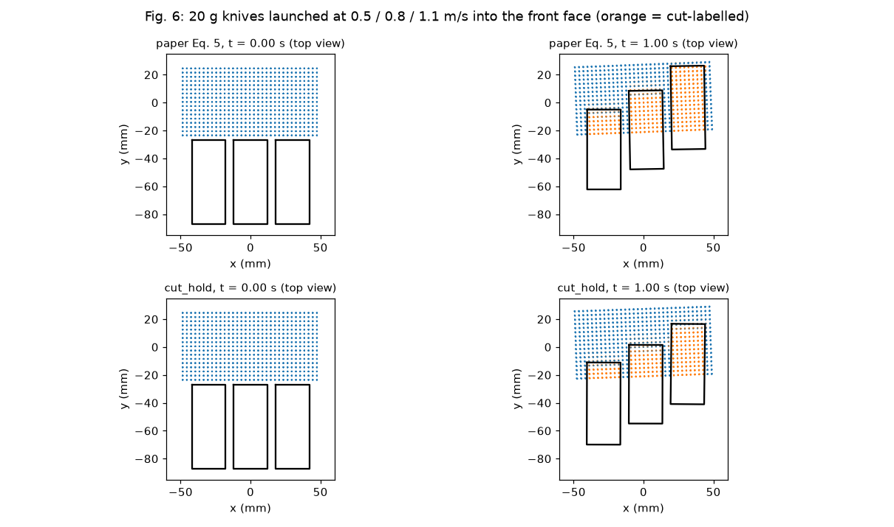

# 实验结果

硬件：tams61，RTX 4060 8 GB，Warp 1.18.0，MuJoCo 3.3.7。运行目录在 tams61 的 `runs/` 下（不进仓库）。

## 2026-10-18 表面、独立对照与压力测试

代码 `bd9c014`；tams61 全套 372 项、18 个子用例通过（79.29 s），7 项外部构建测试跳过。CRESSim 原版及修正模式分别通过 47 项本地集成测试。以下开发验证保留各自 manifest 中的提交与 dirty 状态，最终干净提交的计时单列。

**表面几何。** QEF 单元内缩和多区域弱正则消除了 1.5 mm 参考香蕉的 18 处相交、斜切参考几何的 19 处同块相交。解析切割总体积误差 +0.188%～+0.215%，单片体积误差小于 0.367%；八组弯曲、扭转和分离片块均无相交。实际第 418 帧的点夹连通过拆分不相连的顶点扇修复，三角形位置保持完全一致。

`scripts.surface_observations <recording> --backend cpu --strides 1 --check-all-observations` 对 `review_fix_sequence_final_20261018` 的 532 帧重新重建并检查：所有帧闭合、定向一致、边/顶点流形、无退化三角形；31 帧仍有同块内部穿越（最多 22 处），238 帧存在不同块之间的内部穿越（最多 86 处）。第 63 帧的四处穿越也存在于参考构形，已保存独立交点验证。最终帧同块内部穿越为零、块间为 74 处。报告：`runs/recorded-all-frames-final.json`。

`franka_run ... --motion sequence --record --observation-interval .01` 得到 2,125 个状态；再用 `scripts.surface_observations runs/sequence_10ms_review_20261018 --backend cuda --strides 1 2 4` 比较：10/20/40 ms 最终均为四块、123 条断链、无同块内部穿越，最终体积差 −0.00159% / +0.00161%。相对 10 ms，过程中的断链最多相差 3 / 2 条、节点标签最多相差 5 / 8 个；三角网格不一致的观测为 920/1,063 和 464/532。网格匹配时最大顶点差 2.094 / 0.333 mm。材料观测间的插值仍需改进。报告：`runs/cadence_10_20_40_20261018.json`。

**遥操作与多刀。** `scripts.stress_teleop --device cuda:0 --seed 17 --extra-cuts 20 --surface`：1,905 个物理帧、两次会话、23 次进入/离开材料，重启后保留 21 刀历史，最多两块、560 条断链，全部历史检查通过。`stress_multi_tool --device cuda:0 --seed 17 --steps 120`：三把刀六种排列，分块 `[512,512]` 与切割码完全一致；最大位置差 1.12e-8 m、损伤差 4.18e-5、反力冲量差 7.89e-10 N·s，动量残差 3.50e-8 N·s。同序重复的对应位置/损伤差为 9.31e-9 m / 2.47e-5。Franka 全旋转模拟输入运行 4 s、两刀，GPU 错误为零，min det F = 0.96725。长回放在 `runs/stress_teleop_20_20261018`。

**Fig. 5 独立对照。** 新增原版 CRESSim-MPM `09aa5009` 构建器、共同刀路与评价器。原版共旋分支漏 `break`，结果被线弹性覆盖；`build-cressim --fix-corotated-dispatch` 在构建目录的头文件副本中只补这一行。配置和评价量见 METHOD。

5 mm、0.25 ms 的 BladeMaster 夹具在第二刀后实际分块为 `[1152,864,1440]`，初始坐标划分为 `[1152,1152,1152]`；部分评价四面体跨越实际切口。评价器现在核对粒子成员和切割码，失配时片块体积输出 `null`，比较标记为 `invalid`。原来的 −64% 和 165 个非正四面体属于跨裂口参考点阵的数值，不作为片块收缩结果。

原版 CRESSim 质量单位 1 / 0.01 / 0.001 kg 下，水平动量残差为 5.94e-4 / 5.27e-4 / 5.88e-5 N·s。补齐共旋分支后，质量单位 1e-3 / 1e-5 / 1e-6 kg 的三组在 3.460 / 3.438 / 3.446 s 触发网格边界保护，未完成退刀后的推动；后两组在共同 3.438 s 的粒子位置 RMS 差为 0.440 mm、最大差 7.688 mm。下一步先修正夹具的分块评价、扩大并核对有效计算域及基线收敛，再对齐论文数字。汇总：`runs/blademaster-fig5-mass-unit-sweep.json`、`runs/blademaster-fig5-fixed-unit-sweep.json`。

**优化与在线链路。** `3c328ed` 的按需梯度插值，在同一份 532 帧材料/刀路上做 eager/lazy/lazy/eager CUDA 表面对照：平均 8.092 → 6.622 s（减少 18.2%），所有帧的顶点、三角形和切割码完全相同。另缓存顶点嵌入权重与 GPU 缓冲区。材料、接触和步长保持原设置。报告：`runs/surface_interpolation_ab_20261018.json`。

Mac 经 SSH 到独立 18766 服务，`scripts.live_latency --port 18766 --seconds 15 --rate 60 --start --stop`：624 个已发送输入中，215 个在状态帧中得到准确序号确认；延迟中位数 92.6 ms、p95 132.2 ms、最大 169.2 ms，状态帧间隔中位数 67.4 ms。统计止于 HTTP 接收，浏览器 WebGL 提交与屏幕显示另测。修复跳过的输入被误计为确认、大型场景下载共用 5 s 状态超时，以及关闭表面时的在线初始化错误。报告：`runs/live_latency_review_20261018.json`。

## 2026-10-18 复查：遥操作事件与表面退化情形

commit `e2fc014`。tams61 全套 **294 项测试、18 个子用例通过（56.08 s）**，Ruff、Black（修改文件）与差异空白检查通过。

- SpaceMouse 重复双键报告只生成一次事件；手动切割保留同次采样里的全部按键边沿。`hold` 只停止对应序号及其后续重复采样，新序号速度正常生效。
- HTTP 输入按 NDJSON 行解析，兼容命令跨 chunk 和一个 chunk 内多条命令；包长度限制按命令累计。
- 表面忽略同一时间戳的位姿复位，观测位姿不再补出未执行的切割段。静止刀、压缩样本、换刀时材料节点插值有回归。
- CPU/CUDA CCD 修复共线有限段重叠与首碰时间：固定段 `[0,2]`、刀刃 `[1,3]` 的首碰为 0；刀刃 `[3,5]` 移至 `[-3,-1]` 的首碰为 1/6。CUDA 段坐标改用叉积，避免平行 Gram 项在 FMA 下的消减；三种尺度、端点和反向测试通过。
- 重力刀新增 `--grid-spacing`、`--contact-reference-dt`，结果增加最低刃口高度、方向接触功和损伤计数。材料、接触距离、默认步长与切割公式保持原设置。

**香蕉复跑**（同一干净提交）：

- `franka_run --output runs/recheck_sequence_e2fc014_20261018 --motion sequence --controller libfranka --stiffness 1000 --material paper-banana --duration 30 --surface --surface-embedding cuda --surface-ccd cuda --record`：21.246 s / 35.908 s，**0.592×**；四块 811 / 293 / 225 / 110，峰值力 4.927 N，min det F = 0.9555，GPU 错误和 MuJoCo 警告均为零。532 帧全部闭合、定向一致且坐标有限（`surface_recheck.json`）。
- `franka_run --output runs/recheck_teleop_e2fc014_20261018 --motion teleop --cut-events auto --controller libfranka --stiffness 1000 --material paper-banana --duration 8 --surface --surface-embedding cuda --surface-ccd cuda --surface-precision float32`：8 s / 22.506 s，**0.355×**；两块 1435 / 4，峰值力 4.560 N，GPU 错误和 MuJoCo 警告均为零。材料阶段 13.863 s、表面 5.297 s。同参数重复运行 `runs/recheck_teleop_repeat_e2fc014_20261018` 为 16.871 s、**0.474×**，材料 9.022 s、表面 4.648 s；分块相同，错误和警告均为零。

**Fig. 3(d) 分辨率与步长复测**：`paper_freefall --output runs/recheck_freefall_e2fc014_20261018/<case> --duration 1 --sharpness <0.9|0.5>`；Gc = 100 J/m²，seed = 1。三种配置各两种锋利度，均来自干净提交：

- 10 mm / 2 ms（默认）：均为两块 4308 / 4652，最低刃口约 0.105 mm；达到损伤阈值的粒子为 42 / 0。
- 10 mm / 0.5 ms（`--dt 0.0005 --contact-reference-dt 0.002`）：均为两块 4324 / 4636，刃口约 0.0975 mm；达到阈值为 1 / 0。
- 5 mm / 0.5 ms（再加 `--grid-spacing 0.005`）：均为两块 35708 / 35972，刃口约 0.00294 mm；两种锋利度均无粒子达到阈值，方向接触功约 0.00688 J。

六组 GPU 错误均为零。降低步长时保持刀接触的物理刚度，砧板每步因子仍为 1。加密网格和缩小步长后仍未得到低锋利度刀停在材料内部；下一步检查接触几何、绕刃和侧标签，见 TODO 第 1 项。完整数字在 `runs/recheck_freefall_e2fc014_20261018/summary.json`。

## 2026-10-18 双向审查修复与复测

commit `d4b0635`。212 项测试、18 个子用例通过；Ruff 与差异空白检查通过。香蕉材料、接触参数与步长保持原设置（6 mm：62.5 μs；3 mm：40 μs）。

- 邻居表在重建时加入本步预测位移；1–2 ms、高速、小 skin 的接触数和冲量与完整搜索一致。多刀损伤独立存储。
- 表面记录实际材料子步刀路及刀次/开关，常数段压缩首尾；显示时消费完整历史。帧间进退刀、帧间两刀、绕行与材料经过静止刀均有测试。
- SpaceMouse 轴超时与按钮处理分开；会话重启清旧事件、保留序号水位，加载时的停止请求保留。
- TopoCut 分块查询范围覆盖物体包围盒；细网格内部粒子测试通过。数值试验缓存比较有效配置、协议与干净的 Git 提交；更换接触距离时拒绝旧缓存，原汇总保持不变。

**香蕉三刀**（`franka_run --motion sequence --controller libfranka --stiffness 1000 --material paper-banana --duration 30 --surface --surface-embedding cuda --surface-ccd cuda [--record]`）：

- 带录制 `runs/review_fix_sequence_final_20261018`：21.243 s / 37.886 s，0.561×；四块 811 / 293 / 225 / 110，峰值力 4.917 N，GPU 错误、MuJoCo 警告均为零。
- 不录制 `runs/review_fix_sequence_norecord_20261018`：21.243 s / 37.125 s，0.572×，四块相同。两项都含表面，客户端渲染另计。
- 532 帧网格全部闭合且绕向一致、顶点有限；保留 42,959 个刀路样本。前 120 帧 CPU/CUDA 拓扑相同，坐标最大差 2.36e-15 m，与录制网格一致（`runs/review_fix_surface_equivalence_20261018.json`）。
- 完整刀路的表面计算经整段包围盒筛选、侧标签候选与缓冲复用后，带录制表面耗时 44.38 → 9.36 s；最新扫掠 6.31 s。2026-10-17 的帧端点版本计时另见历史条目。
- 8 s 模拟遥操作（`--motion teleop --cut-events auto --surface-precision float32`，其余相同）：18.498 s，0.432×，两次切割事件，峰值力 4.567 N，无 GPU 错误或 MuJoCo 警告（`runs/review_fix_teleop_20261018`）。同参数的 `2292eb6` 为 12.955 s、0.618×、4.558 N；两版本均分成 1435 / 4。完整刀路的记录与扫掠增加了开销。

**力曲线**：`python -m scripts.force_convergence --output runs/review_fix_force_final_20261018 --spacings 0.006 0.003 --seeds 20`，每种 20 次，全部切透、错误为零。

- 6 mm：平均 1.0903 ± 0.207 N，冲量 1.526 Ns；与旧均值相差 0.074%。
- 3 mm：平均 0.55115 ± 0.031 N，冲量 0.753 Ns；与旧均值相差 0.00064%。
- 旧 80 组记录的配置字段一致；来源分布在四个提交，`h3mm_seed3.json` 标记为 dirty。本次 40 组均来自同一干净提交。

**论文场景复跑**（`runs/review_fix_fig{4,8,6}_20261018`）：Fig. 4 两块 5940 / 2992；Fig. 8 五块 4046 / 952 / 952 / 952 / 952；Fig. 6 三把 20 g 刀停止深度 20.0 / 33.8 / 51.5 mm。物理 wall/sim 分别 0.140 / 0.196 / 0.394。

Fig. 3 默认重力刀复跑（`paper_freefall --output runs/review_fix_fig3_20261018`）：两块 4308 / 4652，1 s 仿真耗时 0.419 s。真实 HTTP 服务的终止后暂停/重启、旧输入清理、加载时停止回归通过。

**TopoCut 式对照复跑**（`scripts.topocut_compare --damaged-shear 0.1`）：Fig. 4 默认 2 ms，BladeMaster 片抬 38.886 mm、其余最大 0.750 mm；MLS-MPM 为 7.538 / 0.976 mm，8 粒子处于 SDF 切口空隙未分配。Fig. 8、0.25 ms 下 BladeMaster 五块分配正确（参考构形谱奖励 5.0），MLS-MPM 得四块，参考谱奖励 −67.24。两次 MLS-MPM 的越界和翻转钳制计数均为零。目录为 `runs/review_fix_topocut_fig{4,8}_20261018`。

## 2026-10-16 香蕉单刀：接触刚度与步长

commit `c3ca5c6`；`franka_run --motion feedback --controller serl --material paper-banana --duration 12 --record`；`runs/dt_sweep_20261016/`。

| 步长 | 接触参数 | 下刀段平均 Fz [N] | 下刀段冲量 [N·s] | 峰值 [N] | 结果 |
|---|---|---|---|---|---|
| 25 μs | 物理刚度 | 0.160 | 0.408 | 0.755 | 两块 |
| 50 μs | 物理刚度 | 0.158 | 0.402 | 0.801 | 两块 |
| 76.9 μs | 物理刚度 | 0.158 | 0.399 | 0.829 | 两块 |
| 50 μs | 固定 \(s_n\)（论文写法） | 0.130 | 0.329 | 0.609 | 两块 |
| 25 μs | 物理刚度 + 区间内刀具预测 | 0.160 | 0.407 | 0.756 | 两块 |

固定物理刚度后，平均力在 25–77 μs 之间相差 < 2%；按上表舍入数值，冲量相差约 2.2%。固定 \(s_n\) 时 50 μs 的冲量低约 19%。峰值仍随步长变化（单个区间的尖峰）。20 mm/s 下刀时，区间内刀具预测与保持不变没有可见差别。

## 2026-10-16 性能

单子步材料耗时（`scripts/probe_substep.py`，外部刀具，不切割）：

| 粒子 | 接触检测 | 修改前 | 修改后 |
|---|---|---|---|
| 1452 | HashGrid | 101 μs | 101 μs |
| 1452 | 全对，每粒子 64 线程 | — | 73 μs |
| 11520 | HashGrid | 215 μs | 217 μs |

1452 粒子时 GPU 远未填满：逐 kernel 计时为接触对 37 μs、p2g 15 μs、刀具接触 11 μs、update_F+塑性 10.5 μs，都是单个线程内的串行延迟（SVD、原子操作、哈希探测），合并 kernel 本身几乎不省时间。

香蕉 + Franka + CUDA 表面完整运行（5.36 s 仿真，`--output` 不带 `--record`）：

| 版本 | 步长 | 实际耗时 | 实时倍率 | 材料 | 机器人 | 观测+表面 |
|---|---|---|---|---|---|---|
| 修改前 `3a6d458` | 25 μs | 29.8 s | 0.180× | 22.4 s | 3.4 s | 3.8 s |
| `1743d71` | 62.5 μs（默认） | 13.5 s | 0.397× | 7.0 s | 2.5 s | 3.8 s |
| `2e30ca7` | 76.9 μs | 13.0 s | 0.413× | 6.4 s | 2.6 s | 3.9 s |

`robot_step` 每步从约 535 μs 降到约 360 μs：SERL 控制器直接传入目标四元数，libfranka 专用的姿态误差只在该分支计算。

## 2026-10-16 论文 Table I：重力刀（Fig. 3）

commit `1743d71`；`python -m blademaster_warp.paper_freefall`；8960 粒子，2 ms，1 s 仿真。

wall/sim = 0.47（RTX 4060）；论文 0.33（RTX 5090）。1 s 内刀转动 65°，材料仍为一块。后来查明是三个问题叠加，见文末"Fig. 3 重力刀复现"；现在的默认设置下刀切透成两块，wall/sim 0.44。

## 2026-10-16 香蕉连续切割（论文 Fig. 1 形式）

commit `a52ec9b`；`franka_run --motion sequence --controller libfranka --stiffness 1000 --material paper-banana --sampling-seed 1 --surface --surface-embedding cuda --surface-ccd cuda --record`；`runs/fig1_sequence/`。

切点 x = +40、+20、0 mm，每刀后推开 12 mm。刀具原点到达底部目标（误差 ≤ 0.5 mm 并保持 0.1 s）后才开始推。

| 时间 [s] | 事件 | 粒子分块 |
|---|---|---|
| 3.52 | 第 1 刀到底 | 140 / 1299 |
| 9.16 | 第 2 刀到底 | 140 / 213 / 1086 |
| 14.92 | 第 3 刀到底 | 140 / 213 / 274 / 812 |
| 17.68–18.15 | 退刀后保持 | 4 块不变，刀上无材料 |

峰值材料反力 7.4 N，最大跟踪误差 8.1 mm（下刀时刀被材料托住），控制力矩无饱和。

18.15 s 仿真用时 32.1 s（0.56×，含逐帧记录）：材料 19.8 s（每子步约 68 μs）、观测与表面 9.6 s（其中 CPU 网格构建 3.4 s、记录 1.9 s）、机器人 2.3 s。

## 2026-10-16 当前提交复核

commit `872c633`；89 项测试通过（16.73 s）。三刀重跑命令：

```bash
.venv/bin/python -m blademaster_warp.franka_run --motion sequence --controller libfranka --stiffness 1000 --material paper-banana --duration 30 --surface --surface-embedding cuda --surface-ccd cuda --output /tmp/blademaster-review-20261016
```

18.164 s 仿真耗时 30.674 s（0.592×），关闭录制和显示，保留物理、观测及表面。四个机械连通块为 878 / 245 / 178 / 138 粒子，退刀后保持；峰值材料力 7.716 N，最大跟踪误差 7.392 mm，最小 det(F)=0.9275，GPU 错误和 MuJoCo 警告均为零。计时排除 JIT、显示初始化和客户端渲染。

## 2026-10-16 多刀后表面尖刺：原因与修复

修复前（`runs/fig1_sequence`）。从上到下为 0、3.5、9.2、18 s；每行左边是表面，右边是粒子。


第二刀以后，中间几块的表面出现翅片和尖刺，而同一时刻的粒子是完整的块。原因在嵌入：表面顶点的位置取自周围编号相容的粒子，编号 0 与两侧都相容。材料按论文 \(h_k = 6\Delta x\) 的宽带给粒子分配侧别，表面却只给被切断连接的两端节点分配，切口附近的外皮节点一直是 0，于是按两块的平均运动移动；块被推开后就被拉成翅片。

修复（`surface.py`）：

1. 表面节点按与材料相同的规则（横向 \(\le 6\Delta x\)、刚被刀刃扫过）分配侧别。
2. 两端在同一刀上分别为侧别 1 和 2 的连接一律视为切断，交点按两端到刀面的有符号距离插值。没有这一条时，个别被扫掠检测漏掉的连接会让一个区域同时带两种侧别，顶点仍跟随两块。

修复后同一任务（6 mm 网格，`runs/fig1_fast`）：


整臂回放（[视频](media/fig1_sequence.mp4)）：


不带录制重跑：18.06 s 仿真用时 28.78 s（**0.628×**）；材料 19.6 s、观测与表面 6.3 s、机器人 2.4 s；4 块（779 / 302 / 220 / 138）。

## 2026-10-16 3 mm 网格的三刀切割

`--spacing 0.003 --dt 0.00003125`，其余同上；`runs/fig1_h3b/`。11485 粒子（6 mm 时 1439），表面间距 1.5 mm。


整臂回放（[视频](media/fig1_sequence_3mm.mp4)，2026-10-17 起为固定 0.5 mm 刀接触距离的重跑 `runs/fig1_h3c`，见下节）：


| 网格 | 粒子 | 分块（粒子数） | 峰值材料力 | 最小 det F | 仿真 / 用时 | 材料 | 观测+表面 |
|---|---|---|---|---|---|---|---|
| 6 mm | 1439 | 876 / 247 / 177 / 139 | 7.7 N | 0.93 | 19.5 s / 33.3 s（0.58×） | 19.8 s | 8.5 s |
| 3 mm | 11485 | 6701 / 2054 / 1678 / 1052 | 2.25 N | 0.91 | 17.8 s / 167.5 s（0.11×） | 132.5 s | 31.4 s |

两者都含逐帧记录。6 mm 时香蕉直径只有约 4 格，截面呈梯形、外皮发块；3 mm 下截面圆润，切面平整。峰值力随网格变化很大（6 mm 的 7.7 N 主要是触板尖峰），力的收敛仍待按论文 Fig. 9 的做法（20 次采样平均 + 加密）检查。

## 2026-10-17 多把自由刀：竖直射入与切割功扫描

**多刀**：`Config(tool_count=K, free_blade=True)`。刀状态数组长度为 K，刀 k 用切割码第 `cut_index + k` 位、自己的反力与刀—颗粒摩擦历史；`contact.blade_at` 从 `rigid_at` 拆出，单刀结果与拆分前的差别等于两次相同运行的 GPU 原子累加噪声（位置 1e-7 m）。测试（`tests/test_multi_tool.py`）：只允许自由刀；交换刀的编号结果不变；镜像放置的两把刀在碰到砧板前完全镜像（碰板后因刀—板逐顶点求解顺序不对称而略有差别，单刀已有的行为）；放在块外的刀严格自由落体。

**Fig. 6**（`python -m blademaster_warp.paper_impact`）：Fig. 8 的块与材料，三把 0.1 kg 刀在 x = −30/0/30 mm 以 0.5/0.8/1.1 m/s 竖直射入。三把刀都几乎不减速地切穿 42 mm 到达板面，与论文"被材料反力减速、速度越大越深"不符。排查：

1. 刀厚 1 mm、接触距离 0.5 mm 时，6 mm 网格下粒子列距 3 mm，刀落在两列之间就谁也碰不到（x = 0 和 30 mm 的刀正是如此）。改用粒子半径后仍然切穿；刀厚 3 mm、粒子抖动采样、刀质量 5–100 g 全部切穿。
2. 规定刀以 50 mm/s 下切同一块，竖直反力与 \(G_c\) 无关：\(G_c\) = 10、100、1000 J/m² 时都是 0.100 N（6 mm 网格）/ 0.030 N（3 mm 网格），而 \(G_c W\) = 0.5–50 N；没有一个粒子的损伤达到 1。

本组运行中，刃前粒子随刀运动后，相对推进速度下降，方向接触功随之减小；粒子未达到损伤阈值就绕到刃后，几何侧标签仍会分离两侧。在以上配置和扫描范围内，\(G_c\) 对力几乎无影响。锋利度效应还需要联合检查刀具几何、接触距离、侧标签和网格；Fig. 6 的侧射结果见后面的对应实验。

另：6 mm 香蕉配置的接触距离 0.5 mm 小于不漏碰的 \(\Delta x/4\) − 半厚 = 1.0 mm，已改，见下节。

## 2026-10-17 切割阻力的两个可选修改；6 mm 刀接触距离下限

### 刀接触距离下限

求解器把刀接触距离提高到至少 \(\Delta x/4\) − 刀半厚（原来只发警告）。香蕉 6 mm 配置由 0.5 mm 变为 1.0 mm；3 mm 及更细网格下限 ≤ 0.25 mm，仍为 0.5 mm，收敛结果不变。全部测试通过。

6 mm 三个视频重录（`runs/fig1_fast3`、`runs/grasp6d`、`runs/teleop6d`，命令同前）：三刀 4 块（763 / 312 / 223 / 141），抓刀 4 块（797 / 278 / 223 / 141），遥操作仍为两道未切透的切口；无 GPU 错误，带录制 0.635×。第一刀切下的尖端在推开前外移 1.9–2.1 mm（上一版 1.3–1.9 mm），即刀的有效半厚 1.5 mm 加少量蠕动，最高瞬时 20 mm/s，切透后不再继续外移，没有"弹走"。

### 切割阻力：问题定位

规定刀以 50 mm/s 下切 Fig. 6 的块（100×50×42 mm，6 mm 网格，刀宽覆盖块宽 50 mm），统计刀正下方一带（\(|x| \le\) 半厚 + 接触距离，238 个粒子）中损伤达到 1 的数量：

| 材料 | 变体 | \(G_c\)=10 | 100 | 1000 J/m² |
|---|---|---|---|---|
| E 20 kPa，屈服 2 kPa | 论文式 (5) | 0.10 N，0 个 | 0.10 N，0 个 | 0.10 N，0 个 |
| | 按刀自身推进速度计功 | 0.10 N，0 个 | 0.10 N，0 个 | 0.10 N，0 个 |
| | 刃前粒子不得绕刃 | 0.29 N，204 个 | 1.95 N，12 个 | 1.95 N，0 个 |
| E 400 kPa，屈服 40 kPa | 论文式 (5) | 1.54 N，17 个 | 1.54 N，17 个 | 1.54 N，0 个 |
| | 刃前粒子不得绕刃 | 1.70 N，221 个 | 3.28 N，221 个 | 29.1 N，88 个 |

（表中为边缘深 12–32 mm 段的平均竖直力。）即使在香蕉的模量（400 kPa）下，论文式 (5) 的力也与 \(G_c\) 无关，几乎所有刀下粒子都在损伤未满时就从刃两侧滑过、按几何分配侧别而分离。所以香蕉预设的 \(G_c\) = 700 J/m² 目前同样不影响切割力。

原因不只是相对速度为零：侧别（断开连接）只按刀刃是否扫过来分配，与损伤无关；损伤只决定刃能否"压穿"粒子。粒子能滑到刃侧，就不需要被压穿。

### 两个开关（默认都关，即论文行为）

- `Config.cut_work="advance"`：式 (5) 的 \(u_{c,p}\) 改用刀刃自身沿切割方向的速度，而不是相对粒子的速度。单独打开几乎没有作用（上表），因为粒子照样绕刃滑走。
- `Config.cut_hold=True`：损伤未满、位于刃口正前方（\(|x| \le\) 半厚 + 接触距离，刃下或刃尖以上不超过同样距离）的粒子，刀只沿切割方向推它，法向取切割方向、距离取到刃线的距离，不能沿斜面或侧面滑开；损伤满 1 后恢复原来的接触并去掉切割方向分量（式 (6)）。侧别分配不变：两侧粒子照常分开，但刃前未断的粒子仍通过网格连接两侧，直到切割能付清。

`cut_hold` 下力随 \(G_c\) 增长：400 kPa 时比论文变体多出 0.16 / 1.74 / 27.5 N，大致正比于 \(G_c\)，即经典的稳态切割力 ≈ \(G_c\) × 宽度 + 摩擦。按阈值 \(G_c A (1-s)/s\)（锐度 s = 0.9）和刃前两列粒子估计应多出 0.11 / 1.1 / 11 N，同一量级；1000 J/m² 时一部分粒子直到触板都没断，力含压缩。20 kPa、屈服 2 kPa 的材料在 \(G_c \ge 100\) 时达到上限 1.95 N：材料先塑性流动、被刀推开，而不是断裂（\(G_c/\sigma_y\) = 5 cm，远大于粒子尺度），力不再随 \(G_c\) 增加。

测试（`tests/test_cut_resistance.py`，小块 400 kPa）：论文变体 \(G_c\) 从 100 到 1000 力不变（0.668 / 0.664 N）；`cut_hold` 下 0.92 → 6.48 N。

### Fig. 6 在两种变体下

`paper_impact --cut-hold [--cut-work advance] --knife-mass M --cutting-energy G`。统计改为用刀的姿态算刃的最低点（原来用刀中心减半高，刀倒下后会显示刃在板下 28 mm；实际是两侧刀碰板后倒在板上）。

- 0.1 kg 刀：论文变体下刀在块内以接近 g 加速（0.5 → 0.98 m/s）；`cut_hold`、\(G_c\) = 100 时基本匀速（0.5→0.6、0.8→0.75、1.1→1.09 m/s），阻力约等于刀重，仍然全部触板。\(G_c\) = 100/300/1000 轨迹完全相同（上面的塑性上限）。
- 30 g 刀（论文未给刀质量）：论文变体仍全部触板；`cut_hold`、\(G_c\) = 100 时三把刀停在不同深度，速度越大越深（10 / 16 / 29 mm），与 Fig. 6 定性一致；但停住后刀下未断的材料像压缩弹簧一样回弹，把两把较轻的刀弹出块外。论文中刀停在材料里。

结论：论文式 (5) 原样实现时，切割能在软材料和香蕉模量下都基本不起作用；`cut_hold` 让 \(G_c\) 以正确的量级进入切割力，但改变了未切断材料对刀的作用，Fig. 6 中会出现回弹，香蕉 \(G_c\) = 700 时的力未测，按上表比例估计为数 N 到十几 N（Franka 刚度 1000 N/m 下需要重新检查能否切透）。默认保持论文行为。

## 2026-10-17 论文 Fig. 7（刀尖十字划痕）与 Fig. 8（连续薄切）

`python -m blademaster_warp.scenarios --scenario fig7-shallow|fig7-deep|fig8 --surface --surface-embedding cuda --surface-ccd cuda`；图 `python -m scripts.scene_surfaces ...`（Fig. 7 用 `--surface-spacing 0.0025`）。两者都是规定刀路（论文用 Franka），\(G_c\) = 10 J/m² 为本地取值。

**Fig. 7**：块 80 × 80 × 70 mm，1 cm 网格，3584 粒子（与 Table I 相同）；E = 6 kPa、ν = 0.35、ρ = 1100（论文）。刀绕厚度轴倾斜 30°，最低的刀角在前，先沿 x、再沿 y 各划 60 mm。重力下顶面先沉降到 66.5 mm（6 kPa 很软，\(\rho g H^2/2E\) ≈ 4.4 mm），深度从沉降后的顶面算：浅 6 mm、深 20 mm。两次都保持一块（不切透）；浅划只切开顶层粒子（粒子间距 5 mm），表面上是细痕；深划切开 4 层，表面是明显切口，两刀在中心相交。


**Fig. 8**：块 100 × 50 × 42 mm，6 mm 网格，7854 粒子（Table I 7922）；Fig. 6 材料 E = 20 kPa、ν = 0.4、ρ = 1200、屈服应力 2 kPa（论文）。从 +x 端每隔 12 mm 切一刀，共 4 刀；刀接触距离用粒子半径 1.5 mm（0.5 mm 时刀正好落在两列粒子之间、谁也碰不到，见下面 Fig. 6 一节）。每刀切到板后刀升到顶面下 12 mm 再向外推 20 mm 帮助倾倒（论文未说明薄片如何倒下）。结果：4 片各 952 粒子；第 1 片在刀推之前、底部刚切开时就自己向外倒下，落地后滑约 20 mm（落地水平速度约 0.3 m/s、动摩擦 0.2 时 \(v^2/2\mu g\) ≈ 23 mm）后静止；最终倾角 90°、84°、61°、42°，后两片斜靠在前一片上，形成叠堆。


## 2026-10-17 Table I 计时（RTX 4060，只计 `ExternalToolPort.advance`）

| 场景 | 粒子 | 0.5 ms，\(s_n\) = 0.1 | 论文步长，\(s_n\) = 0.1 | 论文步长，\(s_n\) = 1（现默认） | 论文（RTX 5090） |
|---|---|---|---|---|---|
| 重力刀（Fig. 3） | 8960 | — | 0.47（2 ms） | — | 0.33 |
| 中间片抬升（Fig. 4） | 8932 | 0.49 | 0.21（2 ms，片未切开） | 0.216（2 ms，片抬 38.6 mm） | 0.36 |
| 刀尖划痕（Fig. 7） | 3584 | 0.37 | 0.17（2 ms） | 0.17（2 ms） | 0.30 |
| 连续薄切（Fig. 8） | 7854 | 0.49 | 0.30（1 ms，4 片只切开 2 片） | 0.30（1 ms，4 片全切开） | 0.56 |
| 多刀冲击（Fig. 6） | 7854 | 0.63（3 把自由刀） | — | — | 0.62 |

以上是粒子对邻居表之前的计时；之后（见“粒子对接触：设备端重建的邻居表”一节）为 Fig. 3 0.42、Fig. 4 0.174、Fig. 7 0.158、Fig. 8 0.232、Fig. 6 0.55。Fig. 4 在当前代码下复核（2 ms，`/tmp` 运行，未入库）：BladeMaster 片抬 38.6 mm、其余最大 0.55 mm（p95 0.18 mm）；单场片最终 0.2 mm，抬刀途中片的中位抬升最高 5.1 mm。

论文步长下 \(s_n\) = 0.1 的问题来自每步罚函数：刚度 \(s_n m/\Delta t^2\)，柱高 N 个粒子时底层穿透约 \(N g \Delta t^2/s_n\)，在 1–2 ms 达到 1.4–4.3 mm，最底层落到刀刃以下而切不开；Fig. 4 的平刀同样托不住片。改为 \(s_n\) = 1（砧板与刀接触都是）后三个场景在论文步长下都得到与 0.5 ms 相同的结果，场景默认已改为论文步长，见文末"大步长下的接触"。

## 2026-10-17 论文 Fig. 4：中间片抬升与单场对照

`python -m blademaster_warp.scenarios --scenario fig4 [--single-field]`，对比图 `python -m scripts.fig4_compare runs/fig4_bm runs/fig4_sf --output ...`。

- 圆柱直径 160 mm、高 56 mm，1 cm 网格，8932 粒子（Table I 8960）；E = 10 kPa、ν = 0.4、ρ = 1100（论文）。刀长 100 mm、高 80 mm，两刀径向切在 ±60°（120° 扇形片），每刀越过轴线 10 mm 使两刀在顶点重叠。刀路为规定位姿（论文用 Franka）；\(G_c\) = 10 J/m² 为本地取值（论文未给，规定刀路下只影响切开前的变形）。
- 抬升：刀放平、刃朝轴线，在圆柱外转向后贴着砧板滑入（刀顶面与板面齐平；规定刀不与板碰撞），只在扇形片下方（\(|y|<50\) mm 在 \(x>29\) mm 处都在片内），再抬 40 mm。
- 单场对照按论文：刀不在切割时，粒子—网格传递忽略切割码（`Solver.set_single_field`）；切割码分配与粒子接触不变，所以两者的分块完全相同（5940 / 2992）。

| | 片的抬升 | 其余材料（最大 / 95% 分位） |
|---|---|---|
| BladeMaster | 38.7 mm（刀抬 40 mm） | 0.1 / 0.0 mm |
| 单场对照 | 3.9 mm，之后刀从片中穿过 | 2.9 / 1.4 mm |


单场下片与其余部分经共享节点粘在一起，刀托不起整体，片被抬起少许后刀从材料中穿出；论文图中是周围材料被一起带起，失败形式不同但原因相同。

调试中发现的两个问题（都已在场景设置中处理）：

1. **2 ms 步长下底层没有被切开。** 砧板接触是每步罚函数，刚度 \(s_n m/\Delta t^2\)；底层粒子承受约 11 个粒子的柱重，平衡穿透约 \(11\,g\,\Delta t^2/s_n\) ≈ 4.3 mm，实测底层从 2.5 mm 沉到 −1.1 mm，低于停在 0.4 mm 的刀刃，于是最底下一层始终没有分配侧别，片在底部与其余部分相连（逐对检查跨切线的相容粒子对，全部位于 2.5–10 mm 高度）。场景默认步长改为 0.5 ms（估计穿透 0.27 mm）。
2. **0.5 mm 刀接触距离下平刀托不住片。** 粒子间距 5 mm，粒子最多被压入 1 mm（刀半厚 + 接触距离）就越过刀的中面、被反向推下；刀上平均只承受 1–2 N（片重 4.0 N）。粗网格改用粒子半径 \(\Delta x/4\) = 2.5 mm（代码默认值）。香蕉细网格仍用固定 0.5 mm。

Table I 计时（只计 `ExternalToolPort.advance`，不含保存与渲染，RTX 4060）：2 ms 步长 0.214 wall/sim（论文 0.36，RTX 5090），但此时片未切开；能切开的 0.5 ms 为 0.49。后来砧板与刀的每步罚因子改为 1，2 ms 下片切开并抬起 38.6 mm（0.216 wall/sim），场景默认已改回 2 ms，见文末。

## 2026-10-17 切下的块被挤出（"弹走"）

旧的 3 mm 录制（`runs/fig1_h3b`）里，第一刀（x = 40 mm）切下的尖端在刀触板前最后 0.25 s 外移 2.1 mm（最高 15 mm/s），到切透时累计 3.25 mm，之后推开阶段才是设计的 12 mm 平移。刀的横向偏差只有 0.27 mm，不是刀被推歪。原因是刀—粒子接触距离取 \(h/4\)：3 mm 网格上刀的有效厚度为 1 + 1.5 = 2.5 mm，刃口楔形把近不可压（ν = 0.45）的材料挤向两侧，最后韧带断开时弹性能释放。

规定刀路竖直切同一位置（3 mm，两个采样种子平均），切透后尖端外移：

| 接触距离 | 摩擦 | 外移 |
|---|---|---|
| \(h/4\) | 0.2 | 1.89 mm |
| 0.5 mm | 0.2 | 1.00 mm |
| 0.5 mm | 0.5 | 1.21 mm |
| 0.25 mm | 0.5 | 0.96 mm |

固定 0.5 mm 后外移等于刀半厚 + 接触距离，切透后不再继续移动；粒子—板摩擦影响很小。Franka 三刀用当前默认值重跑（`runs/fig1_h3c`，dt 40 µs）：切透时外移 1.61 mm、推开前回落到 1.32 mm（旧录制 3.25 → 3.57 mm）；4 块（6102 / 2418 / 1886 / 1079），峰值材料力 1.05 N（旧 2.25 N），带录制与表面 17.7 s / 115.7 s（0.153×）。

6 mm 的三个视频（三刀、抓刀三刀、遥操作模拟输入）也按原参数重录（`runs/fig1_fast2`、`runs/grasp6c`、`runs/teleop6c`）。三刀与抓刀均为 4 块（754 / 301 / 245 / 139），遥操作仍为两道未切透的切口。6 mm 下旧录制的外移本来就小（0.8–1.2 mm，粒子间距大于刀厚，刀挤进粒子之间）；新录制切透后 0.15 s 内外移 1.2–1.7 mm（刀身继续下行挤过切口）后停住。

## 2026-10-16 合并 kernel：没有收益，已撤回

把刚体接触与网格清零合并、形变更新与侧别分配合并，在同一台机器上测子步耗时（`scripts/probe_substep.py`，各测两次）：

| 网格 | 合并前 | 合并后 |
|---|---|---|
| 6 mm，1439 粒子 | 60.4 / 60.5 μs | 65.1 / 60.3 μs |
| 3 mm，11485 粒子 | 227.8 / 227.7 μs | 228.1 / 226.4 μs |

子步已整段在 CUDA graph 里，kernel 之间的启动间隔约 1 μs；耗时来自每个 kernel 自身的延迟（单线程的 `finish_external_step` 也要 3 μs；刚体接触中所有粒子对同一地址做原子累加）。把接触对表的清零也并入 kernel 反而更慢（3 mm 下 126 μs，原生 memset 只要几微秒）。代码已撤回（`2b6ffc8`）。

## 2026-10-16 表面 CPU 开销

三刀序列（6 mm，带记录）：

| | 网格构建 | 观测+表面 | 实时倍率 |
|---|---|---|---|
| 修复尖刺后、优化前 | 7.43 s | 14.1 s | 0.49× |
| 优化后 | 2.03 s | 9.0 s | 0.585× |

改动：边周围格子的角度顺序只取决于参考网格，改为初始化时算一次（原来每次重建都对每条边做 `arctan2` 排序）；节点到格子的索引表代替遍历全部格子；格子内被切断的连接不变时复用上次的 QEF 点，只重算区域编号（侧别带每帧会改变很多节点的编号，但不改变几何）。

## 2026-10-16 香蕉：步长、接触对表、连通块、顶点嵌入

### 3 mm 网格的步长

香蕉 P 波速 \(c=\sqrt{E(1-\nu)/((1+\nu)(1-2\nu))/\rho}\approx 37\) m/s，3 mm 网格的 \(\Delta x/c\approx 81\) μs。单刀（`--cuts 0.02`，8 s，带记录）比较三档步长：

| 步长 | 网格 CFL | 分块 | 峰值材料力 | 最小 det F | 材料用时 | 切后 5–6 s 残余最大速度 |
|---|---|---|---|---|---|---|
| 31.25 μs | 0.39 | 8348 / 3137 | 2.31 N | 0.880 | 41.2 s | 1.8 → 1.1 mm/s，衰减 |
| 41.7 μs | 0.52 | 8325 / 3160 | 2.11 N | 0.904 | 31.5 s | 7.7 → 6.7 mm/s，衰减 |
| 62.5 μs | 0.77 | 8368 / 3117 | 2.18 N | 0.896 | 21.5 s | 5.3 → 13.5 mm/s，动能 0.05 → 0.24 μJ，增长 |

与 31.25 μs 相比，刀具 z 向力逐毫秒的均方根差：41.7 μs 为 0.091 N，62.5 μs 为 0.101 N；同一步长只换采样种子为 0.04–0.18 N，步长带来的差别在采样差别以内。62.5 μs 下切后动能不衰减，判为接近稳定边界，不采用。

`franka_run` 的香蕉默认步长改为 \(\min(62.5\,\mu s,\ 0.5\,\Delta x/c)\) 并向下取到整除 1 ms：6 mm 仍为 62.5 μs（受接触刚度限制），3 mm 为 40 μs。原来只给 `--spacing 0.003` 时默认用 62.5 μs，正落在上面不稳定的一档。

### 其他改动

- 接触对哈希表：原来每个子步把整张表（按每粒子 64 对预留，3 mm 下 8 MB）填 −1；改为记录本步写入的槽位，复用前只清这些。3 mm 子步 228 → 214 μs；6 mm 不变（60–61 μs）。
- 连通块（每次快照、侧别变化时计算）：Python 并查集改为 scipy 稀疏图连通分量，结果逐元素相同；3 mm 下每次 105 → 5 ms。
- GPU 顶点嵌入：原来每种侧别各上传一次粒子数据、对全网格求一次场、读回一次；改为一个 kernel 内每个顶点按自己的侧别求 8 个角点。与 CPU 实现逐顶点一致（误差 1e-12）。
- 试过：刚体接触中先读后比较、只在可能刷新最大值时做 `atomic_max`，无可测收益，已撤回。

### 三刀序列（不录制，含表面）

| 网格 | 分块 | 仿真 / 用时 | 材料 | 观测+表面 | 其中网格构建 / 顶点嵌入 |
|---|---|---|---|---|---|
| 6 mm，此前 | 779 / 302 / 220 / 138 | 18.06 s / 28.78 s（0.628×） | 19.6 s | 6.3 s | — |
| 6 mm，现在 | 794 / 284 / 221 / 140 | 18.10 s / 27.5 s（**0.659×**） | 20.1 s | 4.55 s | 2.25 / 0.81 s |
| 3 mm，31.25 μs（带录制） | 6701 / 2054 / 1678 / 1052 | 17.8 s / 167.5 s（0.11×） | 132.5 s | 31.4 s | — |
| 3 mm，40 μs，仅改步长 | 6739 / 2008 / 1686 / 1052 | 17.76 s / 126.1 s（0.141×） | 97.6 s | 25.1 s | 7.30 / 4.04 s |
| 3 mm，40 μs，现在 | 6720 / 2028 / 1685 / 1052 | 17.77 s / 114.0 s（**0.156×**） | 97.8 s | 12.9 s | 7.15 / 1.59 s |

分块大小的小差异来自浮点原子累加顺序。3 mm 下材料计算占 86%，其中最大的一项是粒子对接触（每子步约 61 μs，主要是对邻居的查询本身）。

## 2026-10-17 夹爪、抓刀与 Franka 遥操作

### 固定安装

刀是 `hand` 的子刚体，装在安装座圆柱（半径 8 mm）下方。原来手指张开 35 mm，看起来像没夹住；现在手指合到 8 mm、贴在安装座上。手指与刀、安装座之间无接触（1.5 s 静止检验），末端跟踪不受影响。

### 抓刀（`--attachment grasp`）

刀是带柄的自由刚体，只靠手指摩擦保持，没有焊接约束。三刀序列（6 mm，带记录）中刀相对手的滑动：

| 设置 | 结果 | 滑动（最大 / 最终） | 转角最大 | 最大跟踪误差 |
|---|---|---|---|---|
| 每指 10 N，MuJoCo 默认接触 | 4 块 | 16.7 / 13.8 mm | 11.3° | 18.9 mm |
| 每指 30 N，默认接触 | 4 块 | 10.9 / 10.9 mm | 4.5° | 13.5 mm |
| 每指 30 N，椭圆摩擦锥、`impratio=10`、noslip 5 次 | 4 块（875 / 248 / 177 / 139） | **1.5 / 1.5 mm** | **0.17°** | 4.7 mm |
| 固定安装（对照） | 4 块 | — | — | 8.3 mm |

不切割时也会滑：静止 2 s 内刀在自重下下滑约 6.5 mm，与夹持力关系不大，是 MuJoCo 默认软摩擦约束的蠕滑（金字塔锥、`impratio=1`）。手指摩擦系数 1.0，30 N/指的摩擦容量远大于刀重 1.3 N。改刀柄 `solref`/`solimp` 反而增加初始嵌入（约 4 mm），未采用。抓刀模式现在默认使用最后一行的设置；noslip 使机器人步进从约 2 s 增至 5.5 s（18 s 仿真）。


[视频](media/fig1_sequence_grasp.mp4)

### Franka 遥操作（`--motion teleop`）

每个 1 ms 机器人步读取最新的刀具线速度、角速度和事件，积分成刀的目标位姿，按当前测得的刀—TCP 相对位姿换算成 TCP 目标交给阻抗控制器。`begin_cut` 开新的一刀（新的切割码位），`end_cut` 关闭切割；在线界面的 `/input` 与独立刀遥操作同一协议，`spacemouse_client` 无需修改即可连接。

不带 `--live` 时使用固定模拟输入：两次下刀各 36 mm（刀刃最低离板 4.5 mm），中间平移 3 cm 并扭转约 6°。结果是两道未切透的切口、仍为一块（6 mm，0.56× 实时，带表面和记录）。切口只出现在刀实际经过的位置。


[视频](media/franka_teleop_mock.mp4)

libfranka 示例的转动增益（10 Nm/rad，阻尼 \(2\sqrt{k}\)）时间常数约 0.6 s，0.2 rad/s 的扭转会滞后几度，停止后收敛。

## 2026-10-17 任意网格间距、自动分刀、int64 切割码、统一刀—板接触

**网格间距**：`--spacing` 可取任意值。格数改为向上取整，网格总能覆盖整根香蕉（原来要求整除，4 mm 这类间距会被配置校验拒绝）。6 mm、3 mm 的粒子数不变（1439、11485）。

**切割码**：三进制切割码由 int32 改为 int64。哈希键是 `码 × 节点数 + 节点`，上限按 \(3^{k+1}\cdot\)节点数 \(< 2^{63}\) 计算：香蕉 6 mm 网格 33 刀，3 mm 31 刀，2 mm 30 刀（原来 19 刀）。大码使哈希的有符号乘法溢出成负槽位，改为无符号运算；表面重建的 19 刀上限同步改为 39 位。

**自动分刀**（`franka_run --motion teleop --cut-events auto`）：切割一直开启，刀离开材料后再进入就开始新的一刀，切割码在离开时就换好。判据是刀身旁（切割带内、刃口以上）是否还有粒子，不用接触力：刀从自己的切口退出时，切口张开，接触力常常恰好为零而刀还在材料里。用接触力判断时，同一条刀路（x = −25 mm 切透、抬刀、x = +25 mm 切透）被数成 3 刀，并有 543 个粒子在第二刀开始前就被标上了第二刀的码（一个码位对应两个切面）；按刀是否嵌入判断为 2 刀、0 个误标，切成 3 块。用刀面推开切块时仍应使用按键模式。

**刀—板接触**：原来导向刀用"刀心不低于半个刀高"的硬止挡（无摩擦、无姿态），位姿伺服刀和自由落体刀用 `tool.step` 的刀顶点—平面接触，Franka 用 MuJoCo。现在导向刀也走 `tool.step`（锁定转动；平移驱动本来就相同），三种内部刀共用同一个刀顶点—砧板接触（速度约束 + 库仑摩擦），并使用与粒子、MuJoCo 相同的有限砧板矩形；Franka 的刀—板接触仍由 MuJoCo 负责。

另外发现：`paper_experiments --driver guided` 用的 DexLab 驱动参数（250 N/m、限力 10 N）推不动论文材料的香蕉，刀刃停在离板约 20 mm 处，从未切开；改动前后结果相同（峰值 5.01 N），与刀—板接触无关。原因是纯比例驱动的稳态误差 \(F/k\)：约 5 N 阻力在 250 N/m 下就是 20 mm。已修复，见文末。

## 2026-10-17 表面重建提速与精度

3 mm 三刀录制（`runs/fig1_h3b`，445 帧、17.8 s 仿真）回放，CUDA 嵌入与 CUDA 碰撞检测：

| 阶段 | 原来 | 现在 |
|---|---|---|
| 网格构建（区域、QEF、三角形） | 9.7 s（含 cProfile 开销；无开销约 5.2 s） | 1.5 s |
| 参考网格建立（一次） | 3.5 s | 0.1 s |
| 表面总计（不含建立） | 11.6 s | 7.3 s |

- 顶点和三角形的组装改成按格子存放区域（每格最多 8 个）后用 numpy 一次生成，顺序与原来相同；三角形与改动前逐帧一致。
- 有界 QEF：三个未知量的箱约束最小二乘，最优解中每个坐标要么自由要么在某一边界上，枚举 27 种组合即得精确解。原来的 SciPy `lsq_linear`（tol 1e-10）在这些米制小问题上提前停止：2100 次有界求解中 2076 次残差高于精确解，因此约 40% 的表面顶点（香蕉表皮处）位置改变，最多一格（1.5 mm），三角形不变。
- 参考网格建立：连杆、Hermite 二分、格子与连杆表全部向量化；拓扑表与原来完全相同，Hermite 数据差 \(<6\times10^{-12}\)。
- 剩余（2026-10-17 在空闲 GPU 上重测，同一回放，CUDA 嵌入与碰撞检测）：表面总计 14.6 s / 445 帧（每帧中位 22 ms、p95 61 ms），其中节点嵌入 1.7 s、顶点嵌入 1.9 s、切割扫掠 1.4 s、网格构建 3.4 s、压缩写盘 6.0 s；CPU 后端 529 s（嵌入 499 s），CUDA 快 36 倍，拓扑逐帧相同、坐标差 \(3\times10^{-14}\) m。网格构建在固定剖分下同样 3.4 s，新的对角线选择只多 0.1 s。表面节点支撑的建立见下文"嵌入支撑分桶"。

精度（`scripts/surface_accuracy.py`）：参考构形下做贯穿切割，每个顶点按自己的切割码属于某一块，真值是香蕉水平集与各切面半空间的交。顶点处水平集的绝对值（以表面格距为单位）：

| 情形 | 表面格距 3 mm：平均 / 最大 | 1.5 mm：平均 / 最大 | 网格闭合 |
|---|---|---|---|
| 未切 | 0.039 / 0.32 | 0.020 / 0.42 | 是 |
| 两道竖切 | 0.035 / 0.32 | 0.018 / 0.42 | 是 |
| 斜切（法向倾斜 0.5 rad） | 0.038 / 0.32 | 0.019 / 0.42 | 是 |
| 6 mm 薄片 ×2 | 0.035 / 0.32 | 0.017 / 0.42 | 是 |
| 3 mm 薄片 ×3 | 0.034 / 0.32 | 0.017 / 0.42 | 是 |

最大误差在所有情形相同，来自香蕉两端的尖头，不是切口。3 mm 薄片在 3 mm 表面格距下只有一格厚，仍然闭合、误差不变。变形后的误差与自交见下文"变形后的表面"。

## 2026-10-17 切削力随网格的收敛（论文 Fig. 9 做法）

`scripts/force_convergence.py`：香蕉中部竖直切透（20 mm/s，刀刃从离板 36 mm 处下到板面，保持 0.2 s），每种网格用不同粒子采样重复，比较 0.4–1.4 s 时间窗内的平均竖直力（冲量同理）。步长按网格取 `banana_dt`，接触刚度按参考步长固定。

| 网格 | 粒子 | 采样次数 | 刀接触距离 \(h/4\)：平均力 | 固定 0.5 mm：平均力 | 固定 0.5 mm：冲量 |
|---|---|---|---|---|---|
| 6 mm | 1439 | 20 | 2.205 ± 0.334 N | 0.275 ± 0.074 N | 0.361 Ns |
| 5 mm | 2504 | 20 | 1.879 ± 0.190 N | 0.346 ± 0.076 N | 0.465 Ns |
| 4 mm | 4883 | 20 | 1.477 ± 0.119 N | 0.439 ± 0.057 N | 0.581 Ns |
| 3.5 mm | 7267 | 20 | 1.294 ± 0.090 N | 0.488 ± 0.042 N | 0.641 Ns |
| 3 mm | 11485 | 20 | 1.073 ± 0.047 N | 0.551 ± 0.033 N | 0.724 Ns |
| 2.5 mm | 19900 | 10 | 0.807 ± 0.024 N | 0.570 ± 0.018 N | 0.754 Ns |
| 2 mm | 38896 | 5 | 0.635 ± 0.011 N | 0.635 ± 0.011 N | 0.829 Ns |
| 1.5 mm | 92233 | 3 | — | 0.646 ± 0.005 N | 0.832 Ns |

全部切透，无 GPU 错误。


原来粒子与刀的接触距离是粒子半径 \(h/4\)，刀的有效厚度是 1 mm + \(h/2\)，随网格变化（6 mm 时 4 mm，2 mm 时 2 mm），稳态力随之近似线性变化，从 6 mm 到 2 mm 降为 1/3.4，不收敛；采样间的离散随加密减小，说明这是系统性的分辨率依赖而不是噪声。断裂能部分与 \(h\) 无关（每个粒子的阈值 \(G_c V^{2/3}(1-\zeta)/\zeta \propto h^2\)，每个粒子在切面上占 \((h/2)^2\)）。

香蕉预设改为固定 0.5 mm（`Config.blade_contact_radius`；粒子之间、粒子与砧板仍用 \(h/4\)）。2 mm 时两者相同。固定后从 2 mm 到 1.5 mm 平均力只变 1.7%、冲量 0.4%：3 mm 偏低约 15%，6 mm 只有收敛值的约 43%，且波动大——6 mm 下粒子间距 3 mm 大于刀厚，刀刃会挤进粒子之间（不切割的压入试验也是如此，见下）。Franka 三刀序列（6 mm）在新设置下仍切成 4 块、任务成功，峰值力 2.0 N（原 7.7 N）。

压入（不切割，压入 6 mm，3 次采样，`scripts/indentation.py`）：6 mm 0.80 ± 0.59 N，4 mm 1.86 ± 0.68 N，3 mm 2.16 ± 0.17 N，2 mm 2.13 ± 0.01 N。没有体积锁死使粗网格变硬的迹象；3 mm 已收敛。

牛顿黏性 0、2、5、20、50 Pa·s（3 mm，`scripts/viscosity_feel.py`）：稳态力 0.547–0.559 N，基本不变；退刀后 50 ms 材料均方根速度 1.0–1.25 mm/s，1 s 后都是 0.1 mm/s。无黏性时切块也几乎不晃，加牛顿黏性没有可见作用。

刀接触距离下限（\(\Delta x/4\) − 半厚，见上文）在 6 mm 与 5 mm 网格上生效（1.0 / 0.75 mm），重测 20 次采样：6 mm 1.164 ± 0.200 N（冲量 1.528 Ns），5 mm 0.788 ± 0.098 N（1.037 Ns），全部切透。收敛值 0.646 N，6 mm 由原来的 43% 变为 180%，5 mm 由 54% 变为 122%；4 mm 及更细不受影响。粗网格两头都不准：低于下限时刀从两列粒子之间滑过，取下限时刀的有效厚度（6 mm 下 3 mm）等于粒子间距，多挤开一列粒子。Franka 三刀序列峰值力相应由 2.0 N 变为 4.0 N。3 mm 网格（85%）仍是在线运行精度与速度的折中点。

抖动采样反射修正（`392ee72`，修正前 6 mm 最低粒子初始弹起 8.4 mm、3 mm 1.2 mm）之后重测（代码同 `2a57511`，`python -m scripts.force_convergence --output runs/force_convergence_20261017b --spacings 0.006 0.005 0.004 0.003 --seeds 20`，summary 记录 revision 与命令）：6 mm 1.091 ± 0.206 N（冲量 1.530 Ns），5 mm 0.765 ± 0.104 N（1.087 Ns），4 mm 0.443 ± 0.061 N（0.621 Ns），3 mm 0.551 ± 0.031 N（0.754 Ns），全部切透、无 GPU 错误。相对收敛值 0.646 N：6 mm 169%（原 180%），5 mm 118%（原 122%），4 mm 69%、3 mm 85% 不变。弹起只影响粗网格，结论不变。

Fig. 1 三刀序列重跑（6 mm，`python -m blademaster_warp.franka_run --motion sequence --controller libfranka --stiffness 1000 --material paper-banana --duration 30 --surface --surface-embedding cuda --surface-ccd cuda --output runs/fig1_rerun_20261017`）：任务成功，四块 795 / 297 / 225 / 122（原 794 / 284 / 221 / 140），退刀后保持、刀上方无材料，峰值力 5.3 N（原 4.0 N），最小 det F 0.965。该次 GPU 被其他进程占满（0.45×），实时比不作计时结果；计时仍以上文空闲 GPU 的 0.80× 为准。

## 2026-10-17 导向刀驱动、连续切割的到底判定

**导向刀**：论文没有给导向驱动。论文材料香蕉的峰值切割力约 5 N，DexLab 的 250 N/m 比例驱动下刀滞后 20 mm，到 2 s 退刀时刀刃仍在板上 13 mm。论文材料预设改为 1000 N/m（与 Franka 笛卡尔刚度相同）、对 0.1 kg 刀临界阻尼 20 N·s/m，限力仍 10 N；DexLab 基线不变。`paper_experiments --driver guided` 的单刀：250 N/m 一块不切开；1000 / 3000 N/m 切成 717 / 722，0.4–1.4 s 平均力 1.18 / 1.23 N（规定刀路 6 mm 为 1.164 N），峰值 4.2 / 4.5 N。`python -m blademaster_warp.run`（DexLab 三刀 + 推开，论文材料）：三刀刀心都到达板面（0.0200 m = 半刀高），最终 4 块 230 / 426 / 493 / 290，0.73× 实时。`paper_experiments` 新增 `--drive-stiffness`、`--drive-damping`、`--drive-force-limit`。

**`CutSequence` 到底判定**：原来只检查刀具原点；现在与单刀 `CutCycle` 相同，刀刃两端也必须在板面容差内，倾斜刀只有一角着板时不推开。6 mm Franka 三刀与抓刀序列重跑：都走完（`done`），4 块 763 / 312 / 223 / 141 与 797 / 278 / 223 / 141，与之前相同。

## 2026-10-17 大步长下的接触：砧板与刀的每步罚因子

论文 Eq. 11 的法向冲量 \(j_n = s_n m_e (-\text{预测间隙})/\Delta t\)，\(s_n\) < 1 时每步只消去一部分预测穿透。砧板不动、质量无穷，每个粒子只有一个砧板接触，可以取 1（每步消去全部预测穿透，相当于速度层面的硬约束）；新增 `Config.board_normal_scale`（0 = 沿用粒子接触的 \(s_n\)，默认；不随步长缩放）。2 ms 下 6 cm 高的块静置 1 s（`tests/test_board_contact.py`）：\(s_n\) = 0.1 时底层沉入板面 6.0 mm，取 1 时 0.3 mm。

只改砧板不够：Fig. 4 在 2 ms、砧板取 1 时片已切开（5940 / 2992，与 0.5 ms 相同），但刀只把片抬起 0.2 mm——片重通过同样软的刀接触把粒子压过平刀中面。刀接触 \(s_n\) 扫描（2 ms）：0.3 抬 0.3 mm，0.6 抬 9.5 mm，1.0 抬 38.6 mm（其余材料最大 0.5 mm，0.5 ms 时为 38.7 / 0.1 mm）。

Fig. 4 / 7 / 8 场景默认改为论文 Table I 步长（2 / 2 / 1 ms），\(s_n\) 与砧板因子都取 1。与原 0.5 ms 结果对照：

| 场景 | 0.5 ms，\(s_n\) = 0.1 | 论文步长，\(s_n\) = 1 |
|---|---|---|
| Fig. 4 片抬升 | 38.7 mm，其余 0.1 mm | 38.6 mm，其余 0.5 mm |
| Fig. 4 单场对照 | 片抬 3.9 mm 后刀穿出 | 片抬 0.2 mm（最大 1.1 mm）后刀穿出 |
| Fig. 7 深划 | 一块，切开 4 层（顶面下 15 mm） | 相同 |
| Fig. 7 浅划 | 一块，切开顶层 249 粒子 | 一块，切开 2 层 494 粒子 |
| Fig. 8 | 4 片，倾角 90° / 85° / 61° / 43° | 4 片，90° / 85° / 63° / 44° |

Fig. 7 浅划的差别：两次刀最低点都在 60.5 mm，第二层粒子在刃下约 2.5 mm，正好在接触距离（粒子半径 2.5 mm）边上，接触刚度不同就分到不同层；两者都是不切透的浅痕。香蕉预设不变（62.5 μs 下 \(s_n\) = 0.625，砧板穿透远小于 1 mm）。

## 2026-10-17 Fig. 3 重力刀复现

`python -m blademaster_warp.paper_freefall --duration 2`；图 `python -m scripts.fig3_freefall <run> --output ...`。论文：0.1 kg 刀以 25° 倾角释放在 E = 6 kPa、ν = 0.4 的块上方，只受重力和材料反力，材料反力使刀转动、轨迹偏转，切透后新切面互相接触滑动而不重连；锋利度低时切不透（Fig. 3(d)）。

原来 1 s 内不切透是三个问题叠加：

1. **倾斜轴**：论文只给角度。原来绕刀长轴倾斜（刀面倾斜），竖直下落时刀面斜压材料：\(s_n\) = 0.1 时刀从材料中沉过去、最后平躺在板上块的下面（刀内仍有 30–40 个粒子，不物理）；\(s_n\) = 1 时刀转到 50° 卡在离板 29 mm 处。改为绕刀厚轴倾斜（刃倾斜、一角先入），与论文"反力转动刀"的描述一致。
2. **2 ms 下的接触**：同前文 Fig. 4，\(s_n\) 与砧板因子取 1。
3. **砧板上的底层不分侧别**：抖动采样使部分底层粒子中心离板只有 0.5–1.3 mm（小于粒子半径 2.5 mm）。刀落到板上后略有俯仰，刀旁 20 mm 处的这些粒子在刀的局部坐标下位于刃线以下，侧别带判据（只标刃线以上的粒子）永远不标它们；未标粒子与两侧都相容，经共享节点把两半连成一块（22 个节点同时有 0/1/2 三种码）。修改 `contact.assign`：刃在该处离板不超过一个粒子半径时，刃高以上一个半径内的粒子也按侧别标记（被刃压在板上的材料已被切断）。`tests/test_pinched_labels.py`（俯仰 10° 的刀落到板上；修改前失败）。

结果（2 ms，8960 粒子，`--tilt-axis thickness`，默认）：下角 0.11 s 入块，倾角 0.09–0.19 s 内由 25° 转到 0°（低端被材料托住、高端继续下落），0.19 s 刀刃整体到板，切成 4306 / 4654 两块，之后刀平躺于切口底部；刀水平偏移 4.5 mm。wall/sim 0.44（RTX 4060；论文 0.33，RTX 5090）。



**Fig. 3(d) 仍未复现**：本组锋利度 0.5 与 0.9 均切成两块、轨迹接近；粒子损伤未满时已按几何分配侧标签。修正后的 `cut_hold` 和低锋利度停刀结果见后面的 Fig. 3(d) 实验。

回归：全部测试通过；Franka 三刀 4 块 763 / 312 / 223 / 141、Fig. 4 5940 / 2992、Fig. 8 4046 + 4 × 952，与修改前相同。

## 2026-10-17 粒子对接触：设备端重建的邻居表

粒子对接触只作用于两类粒子对：切割码不相容的，以及参考构形中相距 ≥ 2 格的（自接触）；绝大多数相邻粒子对相容且参考距离近，被 `pair_at` 直接跳过。原来每个子步重建哈希网格并遍历全部邻居。现在（`pair_search="list"`，`auto` 的默认）：

- 重建时为每个粒子收集 \(q>p\)、距离 < \(2r+\)skin（skin 默认粒子半径）且不被跳过的伙伴，最多 16 个；超出的粒子在接触时改为遍历本次重建的桶（不会漏）。
- 每个子步先检查：任一粒子 \(|x-x_\text{built}|+\Delta t|v|\) > skin/2，或切割码与重建时不同，就在 CUDA 图的条件节点里重建。前者保证不在表里的粒子对当前距离 > \(2r+\Delta t|v_p-v_q|\)（`pair_at` 的作用距离），所以接触集合与逐步查询相同。
- 条件节点里不能用 `wp.HashGrid.build`（内部排序需要分配显存，条件子图不允许分配节点，建图时报 invalid argument），改为自建的格子哈希桶链表（`atomic_exch` 挂链表头，查询时核对格子坐标，防止哈希冲突重复访问）。

`tests/test_pair_list.py`：6 mm 香蕉切割中每 250 ms 用同一状态分别算一次，接触数相同，冲量相对误差 < \(10^{-4}\)。

竖直切透 2.5 s（`banana_dt`，CUDA 图，RTX 4060；wall/sim）：

| 网格 | 粒子 | 原方法 | 邻居表 | 平均力（原 / 表） | 重建 / 子步 |
|---|---|---|---|---|---|
| 6 mm | 1439 | 1.068（all）/ 1.816（hash） | 1.006 | 1.075 / 1.075 N | 890 / 39984 |
| 5 mm | 2504 | 1.388（all） | 1.121 | 0.805 / 0.810 N | |
| 4 mm | 4883 | 3.041（hash） | 1.523 | 0.451 / 0.451 N | |
| 3 mm | 11485 | 5.466（hash） | 2.999 | 0.550 / 0.551 N | 1909 / 62475 |

分块全部相同。重建主要发生在切割中（侧别每步变化）。Franka 三刀序列（无录制）：6 mm 0.80× 实时（原 0.66–0.75×），3 mm 0.306×（原 0.156–0.174×，墙钟 102 s → 58 s）。3 mm 分块：哈希 6179 / 2341 / 1885 / 1080（两次相同），邻居表 6169 / 2351 / 1886 / 1079（三次中两次如此，另一次差 1 个粒子）——同一状态下接触相同，差别来自原子累加顺序不同的浮点差异经 17 s 切割与推开后的放大。Table I 计时（论文步长）：Fig. 3 0.42（原 0.44），Fig. 4 0.174（原 0.214），Fig. 7 0.158（原 0.17），Fig. 8 0.232（原 0.30），Fig. 6（0.5 ms，3 把刀）0.55（原 0.63）。

## 2026-10-17 原子累加与 p2g 散射：三种改法都没有收益，已撤回

逐内核 GPU 时间（`python -m scripts.probe_substep --kernels`，刀在香蕉内，邻居表之后）：3 mm（11485 粒子）每子步 160 μs，其中 `p2g` 41、`g2p_remap` 22、`rigid_and_speed` 18.9、`update_F_plastic` 18.8；6 mm（1439 粒子）100 μs，`rigid_and_speed` 12.3。

- **刚体接触的原子累加**：去掉砧板反力的原子累加（所有底层粒子写同一地址）后 `rigid_and_speed` 仍为 12.6 μs（原 12.3）；之前去掉 `atomic_max` 也无变化。刀的反力、力矩、功只有接触刀的几十个粒子写。粒子数增加 8 倍耗时只多 1.5 倍，这个内核受单线程计算（斜刃多边形最近点、四元数旋转）的延迟限制，不受原子竞争限制，块内归约没有可省的东西。
- **p2g 线程布局**：(n, 8) 改为 (8, n)（同一 warp 内是不同粒子的同一模板位置，地址更分散）：3 mm 41 → 46 μs，更慢。
- **p2g 改为收集**：拓扑变化时为每个槽位建"贡献者"定长表（每格最多 8 粒子 × 8 格 = 64 项），每槽一个线程求和、无原子操作；与原子散射在 \(10^{-5}\) 内一致，但 3 mm 41 → 92 μs、6 mm 10 → 25 μs：每槽串行遍历最多 64 项，且每个粒子的应力被 8 个线程分别读取。

结论：在这块 GPU 和这些规模上，原子散射已是最快的写法。

## 2026-10-17 抖动采样的初始弹起；表面初始化；四边形对角线；`--dt` 下的接触刚度

- **初始弹起**：抖动采样（`sampling_seed > 0`）把部分底层粒子放到离板 0.22 mm 处，低于砧板接触距离 \(h/4\)（6 mm 网格 1.5 mm）。第一步的预测罚接触把它们推回接触面，冲量把整根香蕉抬离砧板约 8 mm（t = 0.04 s）。修复：抖动后把低于 \(h/4\) 的粒子按该平面反射（`geometry.points`）。`tests/test_geometry.py`。
- **`MaterialEmbedding` 建立**：表面节点支撑改为按需构建（`cached_property`）没有节省：`SurfaceRecorder.update` 每帧都调用 `node_state`，3.8 s 只是从建立挪到了第一帧（3 mm：CUDA 建立 0.24 s，首帧 5.70 s）。实际修复见下文"嵌入支撑分桶"。
- **四边形剖分**：对偶网格的四边形原来固定沿 (0,1,2)+(0,2,3) 剖分，非凸四边形会自身折叠。改为取两半法向更一致的对角线（差值超过 `QUAD_SPLIT_MARGIN = 1e-6` 才换，避免近平面四边形在 CPU/GPU 舍入下选得不同）。参考网格的边–三角形自交：3 mm 表面格距 116 → 0，1.5 mm 380 → 18。换用的对角线若与相邻多边形的边重合（一格多区域时），该四边形保持默认剖分，否则会产生非流形边（3 mm 三刀回放 445 帧中 116 帧）。修正后与固定剖分相同：只剩第 219 帧 1 条非流形边，固定剖分下同样存在，来自区域拓扑而不是剖分。
- **第 219 帧非流形边**：这条边 (4150, 4159) 来自一条被切断、但两端节点在所有相邻格子里属于同一区域的连接：两端各生成一个顶点环相同、绕向相反的四边形，即材料内部的双层面，与外表面共边，一条边被 4 个三角形使用。被切断连接若两端在每个相邻格子中的角点环都相同，就不再为它生成面（`surface.triangulate`）。四边形回退也加了反方向：当前对角线被使用超过 2 次而另一条未被使用时换过去。`tests/test_surface.py` 覆盖两个方向的回退与孤立切断连接（结果闭合流形），参考实现 `loop_mesh` 补上了回退。`python -m blademaster_warp.benchmark_surface runs/fig1_h3b --cuda-ccd`（`runs/benchmark_surface_h3b_20261017/report.json`）：445 帧当前网格零违规（无非流形边），CPU 与 CUDA 拓扑逐帧相同、坐标最大差 \(3.1\times10^{-14}\) m，`equivalent: true`。与原录制网格相比从第 195 帧起不同（剖分与双层面改变），这是预期的。该次 GPU 被其他进程占满，耗时（CPU 570 s、CUDA 17.4 s）不作计时结果。
- **`--dt` 覆盖时的接触刚度**：`scenarios.scene_config` 在给定非默认步长时设 `contact_reference_dt` 为场景默认步长，接触刚度 \(s_n m/\Delta t^2\) 保持不变；否则 0.25 ms 下刚度是 2 ms 时的 64 倍。同时给出的 `--normal-scale` 原来也被当作默认步长下的值再缩放（Fig. 4 `--dt 0.0005 --normal-scale 0.1` 实际每步 \(s_n\) = 0.00625）；现在它是实际步长下的每步因子，manifest 记录 `contact_scales_at_dt` 并在开始时打印。上文 Table I 的"0.5 ms，\(s_n\) = 0.1"一列测于 `00d5b8e`，早于引入缩放的 `e06c639`，当时 0.1 就是每步值，数字不受影响；`e06c639` 之后没有用 `--dt` 加 `--normal-scale` 得到的结果。

## 2026-10-17 变形后的表面：嵌入误差与自交

`python -m scripts.surface_deformed`：粒子按已知光滑映射 \(\varphi\) 移动，\(F=\nabla\varphi\) 取精确值；每个表面顶点与 \(\varphi\)(参考位置) 比较（嵌入对仿射映射精确，误差只来自非线性部分）。切块刚体分开时每个顶点必须跟随自己那块。自交：网格边穿过与它不共顶点的三角形。误差以表面格距为单位：

| 材料网格 | 变形 | 顶点 | 平均 / p99 / 最大 | 自交（参考网格） |
|---|---|---|---|---|
| 6 mm | 弯曲 R = 150 mm | 1374 | 0.004 / 0.010 / 0.014 | 0（0） |
| 6 mm | 弯曲 R = 60 mm | 1374 | 0.011 / 0.029 / 0.037 | 0（0） |
| 6 mm | 扭转 10 rad/m | 1374 | 0.006 / 0.015 / 0.019 | 0（0） |
| 6 mm | 三块刚体分开 | 1550 | 0 / 0 / 0 | 0（0） |
| 3 mm | 弯曲 R = 150 mm | 5402 | 0.002 / 0.005 / 0.007 | 9（18） |
| 3 mm | 弯曲 R = 60 mm | 5402 | 0.005 / 0.014 / 0.018 | 9（18） |
| 3 mm | 扭转 10 rad/m | 5402 | 0.003 / 0.007 / 0.012 | 18（18） |
| 3 mm | 三块刚体分开 | 6106 | 0 / 0 / 0 | 18（18） |

网格加密一倍，以格距为单位的误差约减半，即绝对误差约为四分之一（二阶）；变形不增加自交，3 mm 剩下的 18 处来自参考网格本身。

## 2026-10-17 在线遥操作路径的延迟

`python -m scripts.live_latency --port <port> --start` 以 60 Hz 推送模拟操作输入（与 SpaceMouse 客户端相同的分块 `POST /input`），并像浏览器一样轮询 `GET /state`。状态包新增 `input_seq`（生成这一帧的最后一步所用的操作命令序号），对每条命令记录它第一次出现在收到的帧里的时间。场景：论文材料香蕉 6 mm，`--motion teleop --surface --surface-embedding cuda --surface-ccd cuda`，实时倍率约 0.65（每 40 ms 仿真一帧，即约 61 ms 墙钟一帧），RTX 4060。

| | 命令 → 首次出现在帧中：中位 / p95 | 帧间隔中位 | 每帧（gzip） |
|---|---|---|---|
| GPU 机本机回环，改动前 | 46 / 75 ms | 65 ms | 103 kB |
| GPU 机本机回环，改动后 | 40 / 68 ms | 61 ms | 51 kB |
| Mac 经 SSH 隧道（Tailscale，ping 23–37 ms），改动前 | 161 / 232 ms | 117 ms（丢一半帧） | 104 kB |
| Mac 经 SSH 隧道，改动后 | 100–127 / 146–171 ms | 63–67 ms（不丢帧） | 51 kB |

隧道两次测量的差别来自网络波动。浏览器端（`window.liveDiagnostics.timing`，经同一隧道）：JSON 解析中位 0.6 ms，几何更新（含 `computeVertexNormals`）1.4 ms；绘制到屏幕还要等下一次 `requestAnimationFrame`（60 Hz 显示器最多 16.7 ms），在代理的后台浏览器里无法测量。

改动：
- **SpaceMouse 客户端从未能连上在线服务器**：服务器对所有响应 gzip 压缩，`spacemouse_client` 却直接 `json.loads(response.read())`，第一次读状态就抛 `UnicodeDecodeError` 退出。现在按 `Content-Encoding` 解压；`tests/test_live.py::test_spacemouse_client_streams_to_live_server` 让真实客户端连真实服务器（修复前失败）。
- **显示坐标取整到 1 μm**：float32 坐标转 float64 后以 17 位有效数字写入 JSON；取整后每帧 103 → 51 kB（gzip）。只影响浏览器显示，记录不受影响。
- **长轮询**：`GET /state?after=<seq>` 在没有新帧时最多挂起 0.5 s，新帧发布即返回；浏览器不再固定间隔 35 ms 轮询。
- **HTTP/1.1 持久连接 + `TCP_NODELAY`**：原来每帧新建 TCP 连接，经隧道多一个往返并重新慢启动。只开持久连接时本机回环反而 40 → 80 ms：响应头与响应体是两次写，Nagle 等待客户端的延迟确认（Linux 40 ms）；关闭 Nagle 后恢复。

剩余延迟的构成（隧道）：一次单程上行、命令在服务器端等待下一帧（平均半个帧间隔约 30 ms）、一帧 51 kB 经约 25 ms 往返链路的传输（突发受拥塞窗口限制，约 2–3 个往返）。再降需要二进制/增量编码或更短的帧间隔（每帧都重建表面，帧间隔缩短会降低实时倍率）。

## 2026-10-17 TopoCut 式单场 MLS-MPM 对照（方案 A）

TopoCut（Wang et al., CoRL 2025）基于 FluidLab 的 Taichi MLS-MPM：单一速度场，粒子按体积变化 \(J\) 越过阈值标为损伤（式 6），屈服应力软化（式 7）；切口和分块在每刀之后另做：把刀的扫掠体积挖出粒子 SDF，Marching Cubes 提取等值面，网格连通分量即分块（附录 7.6），再用 Laplace–Beltrami 谱奖励与目标形状比较（式 2–3、12–17）。这里在 Warp 中重写了这三部分：

- `blademaster_warp/mlsmpm.py`：MLS-MPM（二次 B 样条、APIC、共旋弹性 + Hencky von Mises），损伤粒子剪切模量乘 `damaged_shear`（论文没有给出损伤后的本构，0 / 0.1 / 1 三种都跑）。粒子、材料、步长、重力、砧板与刀的接触冲量都与 BladeMaster 相同（`contact.rigid_and_speed`，不切割），两者只差场的表示与分离方式。奇异值下限 0.05（同 PlasticineLab 的 von Mises 返回映射；FluidLab 没有下限）；粒子坐标非有限或离开网格时报"发散"。
- `blademaster_warp/topocut_topology.py`：粒子 SDF（体素 = 半个粒子间距，影响半径 = 粒子间距）、扫掠体积至少 2 个体素厚、\(z\ge0\) 截断、Marching Cubes、Laplace 平滑、去掉负体积的空腔面、按缠绕数把粒子分给最近的块；一刀没分出新块时，刀路累积到下一刀一起挖（楔形切块需要多刀）。
- `blademaster_warp/spectral.py`：512 点、k = 30 近邻图、最小 30 个特征对、匈牙利匹配；分段线性奖励 \(\gamma=0.05,\tau=10,\delta=0.1\)（论文未给，按"同形状重采样距离约 2、5×5 与 6×6 mm 截面小棒约 55"标定）。

`python -m scripts.topocut_compare --scenario fig8|fig4 --output runs/... --damaged-shear 0 0.1 1 [--dt 0.00025]`，两种求解器用同一 `ToolState` 序列（规定刀路）。评价：分块粒子数、纯度（每个目标块落在其主块里的比例）、谱奖励（最终变形形状）、参考构形谱奖励（同样的分块取参考位置：只看分块对不对，不受倒下切片弯曲的影响）。

**静置与损伤参考**（2026-10-17，commit `f31bae8`）：场景从未受力的块开始，刀在 t = 0 已处于切割状态。原来式 (6) 的 \(J\) 相对参考构形计算，10 kPa 的 Fig. 4 圆柱只在重力下（刀停在高处）就有 2310 / 8932 个粒子被标为损伤（2 ms；0.25 ms 时 1524 个），Fig. 8 在 1 ms 下 32 个。TopoCut 的任务从静止状态开始，所以现在两种求解器都先在刀停在第一帧位姿、不切割的情况下静置 1 s（`--settle`），MLS-MPM 在静置结束时以每个粒子当时的 \(J\) 为参考（`MlsSolver.start_damage`，式 (6) 用 \(J/J_\text{settled}\)），静置期间不计损伤。同样静置下损伤粒子为 0（`tests/test_mlsmpm.py`）。下表为这一设置的结果（`runs/topocut_{fig8,fig4}_settled[_dt025]`；Fig. 4 下片的抬升从静置后算起）。

Fig. 8 连续薄切（7854 粒子，4 刀，每刀后推倒切片；满分 5）：

| 步长 | 求解器 | 结果 | 分块 | 纯度最小 | 谱奖励 / 参考构形 | 切片倾角 |
|---|---|---|---|---|---|---|
| 1 ms（论文） | BladeMaster | 完成 | 4046 + 4×952 | 1.0 | 3.0 / 5.0 | 90° / 83° / 58° / 41° |
| 1 ms | MLS-MPM ×0 / ×0.1 / ×1 | 静置中 t = 0.33 s 发散（刀未接触材料） | | | | |
| 0.25 ms | BladeMaster | 完成 | 4046 + 4×952 | 1.0 | 4.6 / 5.0 | 90° / 88° / 61° / 40° |
| 0.25 ms | MLS-MPM ×0 | 刀路 20.1 s 时 1 个粒子离开网格（发散判据） | | | | |
| 0.25 ms | MLS-MPM ×0.1 | 完成 | 2380 / 2380 / 2142 / 952 | 0.5 | −72 / −67 | 1–2°（未倒） |
| 0.25 ms | MLS-MPM ×1 | 完成 | 同上 | 0.5 | −67 / −67 | < 1° |

Fig. 4 中间片抬升（8932 粒子，满分 2）：

| 步长 | 求解器 | 结果 | 片抬升 | 其余材料最大 / 95% | 纯度最小 | 谱奖励 / 参考构形 |
|---|---|---|---|---|---|---|
| 2 ms（论文） | BladeMaster | 完成 | 38.9 mm | 0.8 / 0.2 mm | 1.0 | 1.98 / 2.00 |
| 2 ms | MLS-MPM ×0 | 刀路 8.7 s 时发散 | | | | |
| 2 ms | MLS-MPM ×0.1 | 完成 | 18.4 mm | 9.4 / 0.7 mm | 0.997 | 1.83 / 1.84 |
| 2 ms | MLS-MPM ×1 | 完成 | 0.8 mm | 1.0 / 0.7 mm | 0.995 | 1.89 / 1.91 |
| 0.25 ms | BladeMaster | 完成 | 38.4 mm | 0.4 / 0.0 mm | 1.0 | 1.98 / 2.00 |
| 0.25 ms | MLS-MPM ×0 | 完成 | 11.1 mm | 0.5 / 0.2 mm | 0.996 | −18 / 1.94 |
| 0.25 ms | MLS-MPM ×0.1 | 完成 | 0.0 mm | 0.5 / 0.0 mm | 0.998 | 1.91 / 1.92 |
| 0.25 ms | MLS-MPM ×1 | 完成 | 3.6 mm | 1.7 / 0.7 mm | 0.996 | 1.91 / 1.91 |



结论：
- 论文步长下 MLS-MPM 不稳定：Fig. 8（1 ms，网格 CFL ≈ 1）只受重力就在 0.33 s 发散，与损伤设置无关；原来记作"×1 刃口粒子翻转"的发散（0.33 s）实际发生在刀接触材料之前。原来 ×0.1 在 1 ms 下能跑完，是因为静置中被误标损伤的粒子软化后压住了这一不稳定。BladeMaster 在 1–2 ms 下稳定。
- 单一速度场下切开的两侧仍共享网格节点。Fig. 8 在 0.25 ms 下损伤少量软化（×0.1）或不软化（×1）时切片与主体粘连、不倒，推片推动整块材料（3 次推片后主体移动 53 mm，BladeMaster ≤ 0.2 mm），后续刀落在错误位置，SDF 挖切也救不回来（结果与修正前相同）。
- Fig. 4 在 2 ms 下 ×0.1 能把片抬起 18.4 mm（修正前 1.2 mm，原因是静置时整片底部被标损伤、软化后托不住），但片仍经共享节点拖动周围材料（最大 9.4 mm），而 BladeMaster 抬 38.9 mm、其余 ≤ 0.8 mm。其余组合片只抬 0–11 mm；×0 在 0.25 ms 下抬起的片已液化变形（谱奖励 −18）。分块纯度在所有完成的运行中 ≥ 0.995：分块由刀路 SDF 决定，问题在力学上的分离。
- 谱奖励对倒下切片的弯曲很敏感：BladeMaster 分块全对（参考构形 5.0），变形后得分在 1 ms 下只有 3.0，因为第 3、4 片斜靠在前一片上弯曲（刚体配准残差）。
- 拓扑重建（SDF + Marching Cubes）每次运行共 0.06–0.13 s（4 刀）。MLS-MPM 的原子累加顺序会使倾倒角在运行间最多差约 8°。
- 未实现 TopoCut 的 MPPI 示范采集与 PDDP 扩散策略；对照只针对仿真与评价部分。

## 2026-10-17 嵌入支撑分桶

commit 见 git log（"Surface: bucketed tent supports"）；测量脚本为一次性探针：3 mm 香蕉 `runs/fig1_h3b` 的前两帧，CUDA 嵌入与碰撞检测，`SurfaceRecorder` 建立后逐帧 `update`，修改前后在同一负载下交替各测 3 次。

表面节点（75768 个，1.5 mm）与材料网格节点的帐篷函数支撑原来逐节点做 k-d 树球查询（Python 循环）；CUDA 嵌入每次求值还会顺带建立 2h 半径的外延支撑，而 `node_state` 从不外延。现在把粒子按边长为支撑半径的格子分桶，每个节点只查周围 27 格，全部向量化（CSR 存储）；CUDA 只在外延求值（顶点嵌入、`field`）时建第二圈。

| | 建立 | 首帧 | 其中节点嵌入 | 顶点嵌入 | 网格构建 | 次帧 |
|---|---|---|---|---|---|---|
| 修改前 | 0.24 s | 5.70 s | 3.7 s | 0.49 s | 1.5 s | 0.026 s |
| 修改后 | 0.24 s | 2.05 s | 0.28 s | 0.24 s | 1.55 s | 0.026 s |

支撑与 k-d 树结果逐节点相同（编号集合相同，权重差 0；香蕉两种采样与方块、半径 h 与 2h 都检查过），第 1 帧的节点位置、节点 F 与表面顶点与修改前逐位相同，所以没有改用"由材料网格节点三线性插值表面节点"的近似。首帧剩下的主要是第一次全量网格构建（1.5 s）。

## 2026-10-17 Maxwell 黏弹性：压入保持后的力松弛

commit `137f028`；`python -m scripts.indentation --spacings 0.006 0.003 --seeds 1 --hold <s> --maxwell-tau <s> --maxwell-fraction <β>`（论文材料香蕉，20 mm/s 压到 6 mm 后保持，不切割）；拟合 \(F_\infty + (F_0-F_\infty)e^{-t/\tau_\text{fit}}\)，跳过保持开始的 20 ms。

| \(\tau\)，\(\beta\) | 网格 | 保持 | 保持起点 → 终点 [N] | \(\tau_\text{fit}\) | \(F_\infty/F_0\) |
|---|---|---|---|---|---|
| 关闭 | 6 / 3 mm | 0.4 s | 2.494 → 2.458 / 1.992 → 1.982 | — | 0.998 / 0.990 |
| 0.05 s，0.5 | 6 / 3 mm | 0.4 s | 2.121 → 1.669 / 1.821 → 1.582 | 0.060 / 0.062 s | 0.84 / 0.89 |
| 0.5 s，0.5 | 6 mm | 2.5 s | 2.447 → 1.588 | 0.604 s | 0.66 |
| 0.5 s，0.5 | 3 mm，3 次采样 | 2.5 s | 1.65–2.11 → 1.14–1.44 | 0.567–0.621 s | 0.69–0.72 |
| 2.5 s，0.2（文献秒级值） | 6 mm | 10 s | 2.492 → 2.154 | 2.94 s | 0.88 |
| 2.5 s，0.2 | 3 mm，3 次采样 | 10 s | 1.68–2.12 → 1.45–1.84 | 2.70–2.95 s | 0.87–0.88 |
| 22 s，0.4（文献分钟级值） | 6 mm | 150 s | 2.499 → 1.762 | 28.7 s | 0.71 |
| \(10^{-6}\) s，0.5 | 6 / 3 mm | 0.4 s | 2.18 → 1.63 / 1.63 → 1.62（压入力 2.22 / 1.64 N，关闭 2.48 / 2.00） | — | 1.00 |
| 1000 s，0.5 | 6 / 3 mm | 0.4 s | 与关闭相同（2.50 → 2.47 / 1.99 → 1.99） | — | 1.00 |

- 衰减时间 \(\tau_\text{fit}\) 全部落在 \(\tau\)（纯位移控制）与 \(\tau/(1-\beta)\)（纯力控制的蠕变时间）之间，为 1.1–1.3\(\tau\)：刀位置固定，但体积模量和刀、砧板的罚函数接触是不松弛的串联柔度。\(\tau \ll \Delta t\) 时该支每步归零，材料就是长期模量；\(\tau \gg\) 试验时长时与关闭相同。没有 GPU 错误。
- 压入速度（3 mm，\(\tau\) = 0.5 s，\(\beta\) = 0.5，6 mm 处的力）：5 / 20 / 80 mm/s 为 1.83 / 1.93 / 2.02 N，关闭时 1.98 / 2.00 / 2.04 N。
- 切削力（3 mm，`scripts/viscosity_feel.py --viscosities 0 --maxwell-tau …`）：关闭 0.553 N（峰值 1.19 N）；2.5 s、0.2 为 0.553 N（1.19 N）；0.5 s、0.5 为 0.564 N（1.40 N），退刀后 1 s 的均方根速度 0.22 mm/s（关闭 0.09），即卸载后的延迟回弹。切削力由断裂和接触决定，文献松弛参数不改变它。
- 精度：保持变形下应力与 FP64 精确解一致到 \(2\times10^{-4}\)（\(\tau/\Delta t\) = 0.01、1、40）。\(F_v\) 起初存为 float32，\(\tau\) = 22 s（\(3.5\times10^5\) 步）时每步增量低于 \(F_v\) 在 1 附近的分辨率，2 万步后松弛量误差 39%；改为 float64 存 \(F_v - I\) 后误差 \(3\times10^{-5}\)。
- 关闭时走原来的 kernel：与改动前的提交（`392ee72`）对比 200 步方块与 300 ms 香蕉压切，差别与同一提交重复运行的差别同级（速度 \(9\times10^{-7}\) / \(5\times10^{-5}\) m/s，来自原子累加顺序），塑性变形、侧别、损伤逐位相同。全部测试 142 项通过。

## 2026-10-17 论文 Fig. 1 摆放（`--layout paper`，默认）

原来的场景里机械臂沿香蕉长轴方向伸出，刀面垂直于伸手方向；论文 Fig. 1 中机械臂在砧板后方、横跨香蕉，刀面在伸手平面内（正面看刀只剩一条线）。现在把机器人底座绕刀心竖直轴转 90°，材料、刀和砧板在世界中不动，刀的安装角随之调整，HOME 关节角不变；`--layout side` 保留原摆放，此前的 Franka 记录都是这一摆放。遥操作输入按机器人底座坐标系解释（x 前、y 左，沿用 WowSkin 约定），随底座一起转。在线页面和录像改为从机械臂正前方、略高处看。

`franka_run --motion feedback --controller libfranka --stiffness 1000 --material paper-banana --duration 12 --record`，commit `59d80a5`：任务成功，两块 719 + 720，抬刀后两块保持分开、刀离开材料，最大跟踪误差 4.5 mm（原摆放 4.7 mm），无饱和步。全部测试 160 项通过。

## 2026-10-17 在线遥操作的实时倍率

py-spy 采样在线服务（6 mm，1439 粒子，表面 CUDA）15 s：等材料读回 62%、表面 10%、遥操作位姿积分 8%、机器人 8%、自动判刀的嵌入计数（单独启动 + 同步读回）6%。仿真 1 ms 需要墙钟约 2.2 ms，其中材料约 1.37 ms（16 子步，约 85 μs/子步），所以 CPU 开销全部去掉时上限也约 0.73×。

改动：嵌入计数复用缓冲、异步拷回、下一间隔读取（判刀延迟 1 ms，`clear_s` 为 20 ms）；遥操作在无输入时直接沿用已限位的位姿，限位中的旋转改为标量计算。模拟输入 8 s（`--motion teleop --cut-events auto --controller libfranka --stiffness 1000 --surface`，CUDA 表面）：0.502× → 0.575×，峰值材料力 4.57 / 4.56 N，自动判刀都是 2 刀。

试过把表面重建放到后台线程（输入本来就是读回的 CPU 副本，帧按顺序处理）：另一线程使用 GPU 后，主线程为新一刀捕获 CUDA graph 时 Warp 1.18 报 `unknown stream`，捕获期间加锁也一样，已撤回。

在线显示的粒子颜色改为按连通块，块编号跨帧保持：切开时与原块共享粒子最多的新块继承原编号，其余新块用从未用过的编号。

### 第二轮（同一基准：模拟输入 8 s，空闲 GPU）

| 改动 | 实时倍率 |
|---|---|
| 上一轮结束 | 0.575× |
| CUDA 表面：在线显示用 float32（`--surface-precision`，`auto` 时在线不录制用 float32，其余 float64）；刀扫掠没有改变任何节点切割码时复用节点状态 | 0.581× |
| 载入刀状态、检查与写出冲量并入每个间隔的 CUDA graph（每毫秒一次 graph 启动，原来另有 3 次单独启动） | 0.615× |
| 热路径的 `np.r_` 改为 `np.concatenate` | 0.614–0.624×（在波动内） |

表面计算核单独计时（11088 个表面节点、1374 个顶点）：节点求值 1.50 → 0.93 ms、顶点嵌入 2.58 → 1.81 ms（float64 → float32），与 float64 的最大差 0.03 μm（节点）/ 0.013 μm（顶点）。没有成倍提升：主要耗时是按支撑粒子的分散读取，不是 float64 运算。

**6 mm 步长不放宽**：Fig. 1 三刀序列（带录制）在 62.5 / 71.4 / 76.9 μs 下都成功切成 4 块（811/293/225/110 与 814/290/225/110），峰值力 4.92 / 4.92 / 4.90 N，实时倍率 0.68 → 0.78（76.9 μs）。但退刀后的保持阶段，62.5 μs 下粒子动能在衰减（最后两秒均值 2.6e-4 → 1.1e-4，最大速度 5–9 mm/s），71.4 μs 为 6.7e-4 → 6.1e-4（19 mm/s），76.9 μs 为 1.20e-3 → 1.14e-3（23 mm/s），不衰减，与 3 mm 下 62.5 μs 的表现相同，判为接近稳定边界。

**网格构建不移到 GPU**：8 s 中只占 0.56 s，且只在切割改变格子时重算；加上启动与读回后净收益约 2%，需要在 GPU 上重写有界最小二乘的 27 种约束组合。

现在的瓶颈：材料子步约占墙钟的 70%（仿真 1 ms 约 1.1 ms GPU 时间）。

## 2026-10-17 Fig. 6 按论文图改为侧射；Fig. 3(d) 与 `cut_hold` 修正

### Fig. 6：刀从前侧面水平射入

论文正文只说"三把刀同时射向同一块"，但 Fig. 6 图中三把刀沿块的长边排开，刀面水平，从前侧面插入，刀柄留在块外。之前一直按竖直向下射入：0.1 kg 刀重约 1 N，大于这块材料（屈服 2 kPa）的塑性犁切阻力，重力会一直把刀往下拉，所以总是切到砧板，与 \(G_c\) 无关。

`paper_impact` 新增 `--launch side|top`，默认 `side`：刀坐标 −z（切割方向）沿 +y，刃沿 x，刀面水平；刃宽 24 mm、沿射入方向长 60 mm，三把刀相距 30 mm 不重叠；刃在前侧面外 2 mm 处，高度在块的中间。切深按刃上最靠前的点沿射入方向越过前侧面计算。

20 g 刀、1 s（`python -m blademaster_warp.paper_impact --output ... --duration 1 [--cut-hold]`）：

| 实现 | 0.5 m/s | 0.8 m/s | 1.1 m/s | 块 |
|---|---|---|---|---|
| 论文式 (5) | 20.0 mm | 33.8 mm | 51.5 mm | 一整块 |
| `cut_hold` | 13.9 mm | 26.6 mm | 41.7 mm | 一整块 |

（停止后的切深；块深 50 mm。）三把刀都被材料减速并停住，初速越大越深，与图注一致。\(G_c\) 从 30 到 1000 J/m² 两种实现下切深都不变：在屈服 2 kPa 的材料里，阻力来自塑性流动和刀面摩擦，不是切割能。论文式 (5) 下最快的刀刚到块背面；`cut_hold` 下三把都留在块内，更接近图。0.1 kg 刀穿出背面（38 / 73 / 174 mm），15 g 刀进入后倾斜约 19°，最快的仍到 52 mm，因此默认刀质量取 20 g（论文未给）。



### `cut_hold` 修正：只挡刃口前方的粒子

原来刃线以上半刀厚加接触距离（约 1.5–3 mm）内、已经越过刃口的粒子也被当成"在刃前"，穿透量按到刃线的距离算。\(s_n\) = 1 时一步就把这段穿透量全部修正掉，大量粒子同时被往前推，Fig. 3 的自由刀因此被甩出 60–210 mm、转过 90° 以上平躺在板上。改为只挡 `front >= 0` 的粒子，越过刃口的粒子按普通接触处理；Fig. 3 中刀不再被甩出。

### Fig. 3(d)：低锋利度切不透

| 实现 | \(G_c\) (J/m²) | 锋利度 0.9 | 0.5 | 0.3 / 0.1 |
|---|---|---|---|---|
| 论文式 (5) | 1、4、15 | 两块 | 两块 | 两块 |
| `cut_hold`（修正后） | 8–30 | 两块 | 一块 | 一块 |
| `cut_hold`（修正后） | 4 | 两块 | 两块 | — |
| `cut_hold`（修正后） | 100 | 一块 | 一块 | 一块 |

论文默认实现下，阈值相差 81 倍刀也照样切透：刃前粒子在损伤满之前就从刃两侧滑开，按几何分配侧别。`cut_hold` 下 \(G_c\) = 8–30 J/m² 时，锋利度 0.9 切透、0.5 切不透，与 Fig. 3(a)–(c) 和 (d) 一致；按相对速度（论文）或刀自身推进速度计功结果相同。

与论文图仍有差别：低锋利度时我们的刀也压到板附近（刃离板 0.1 mm），只是刃下的材料没有断开、整块仍连着；论文 Fig. 3(d) 的刀停在块的中间深度。原因是 1 cm 网格下粒子间距 5 mm，比 1 mm 的刀厚大得多，被挡的粒子横向挪几毫米就绕到刃后，按几何被分配侧别。试过让"被刃推过但没断"的粒子暂不分配侧别：低锋利度时刀停在离板 26–36 mm 处，与图相符；但锋利的刀擦过的粒子（损伤 0.1–0.9，贴在刀面两侧，各个高度都有）也会留着连接两半，锋利度 0.9 也切不成两块。只在刃后一个粒子半径内暂缓则两种都压到板上。这几种都没有采用，侧别分配保持论文的几何规则。

结论：Fig. 6 按图改为侧射后，两种实现都能得到刀被减速、初速越大越深的结果；本组 \(G_c\) 扫描未改变该趋势。Fig. 3(d) 在 `cut_hold` 下能保留材料连接，但刀停的深度不对；当前默认实现仍未得到低锋利度刀停在材料内部的结果。

## 2026-10-17 没切透就拉：整根跟着刀走，不拉丝

脚本化的遥操作输入（`franka_run --motion teleop --material paper-banana`，替换模拟输入）：开始切割，以 40 mm/s 下切，停 0.4 s，再拉刀，录制 4 s。香蕉高约 24 mm。

| 情况 | 刃最低离板 | 分块 | 拉刀 | 香蕉 / 各块移动 | 最大主伸长 | 伸长 > 1.5 的粒子 |
|---|---|---|---|---|---|---|
| 没切透，竖直拔刀 | 4.6 mm | 一整块 | 上 58 mm | 中心 < 0.2 mm（不随刀抬起） | 1.20 | 0 |
| 没切透，沿刀面方向拉 | 4.6 mm | 一整块 | 30 mm | 中心 30.8 mm（整根跟着刀滑） | 1.19 | 0 |
| 没切透，垂直刀面拉 | 3.8 mm | 一整块 | 30 mm | 中心 29.1 mm（整根跟着刀滑） | 1.23 | 0 |
| 切透后垂直刀面拉 | −0.3 mm | 719 / 720 | 30 mm | 被推的一块 30.7 mm，另一块 2.4 mm | 1.24 | 0 |

没切透时刀下 3–4 mm 的材料把两半连着，整根香蕉在板上跟着刀滑动，没有被拉长；切透后只有被推的一块移动。之前在线界面上看到的"拉丝"是表面重建的问题（已修），不是材料本身被拉长。在这些操作下不需要撕裂判据。如果香蕉被固定住（比如被夹爪抓住）再横拉，未切开的部分才会被持续拉伸，那时才需要撕裂判据。
